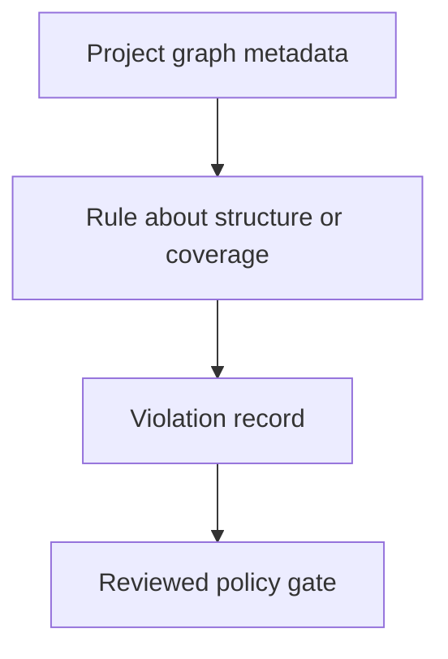

# dbt-project-evaluator and architecture rules

`dbt-project-evaluator` checks architectural conventions such as DAG layering, model naming, documentation and test coverage. The appropriate invocation is version-dependent. The maintainer documents a v1 package workflow and a v2-native checks workflow, so match the evaluator release and command to your engine.

Rules should make your architecture easier to maintain. Explain exceptions, baseline existing violations, and decide when a new violation should fail CI. A documented exception can reflect a legitimate domain requirement.

## Practice

Create a mart that reads a raw source directly. Run the applicable evaluator workflow in a sandbox and locate the corresponding violation. Decide whether to introduce a staging model or record a narrowly scoped exception.

## Recall

How does a project architecture check differ from testing uniqueness of an order ID?

[dbt-project-evaluator](https://github.com/dbt-labs/dbt-project-evaluator)

| Previous | Curriculum | Next |
| --- | --- | --- |
| [← Previous lesson](0032-dbt-expectations-for-richer-data-assertions.md) | [All lessons](index.md) | [Next lesson →](0034-dbt-codegen-sqlfmt-and-dbt-checkpoint.md) |
