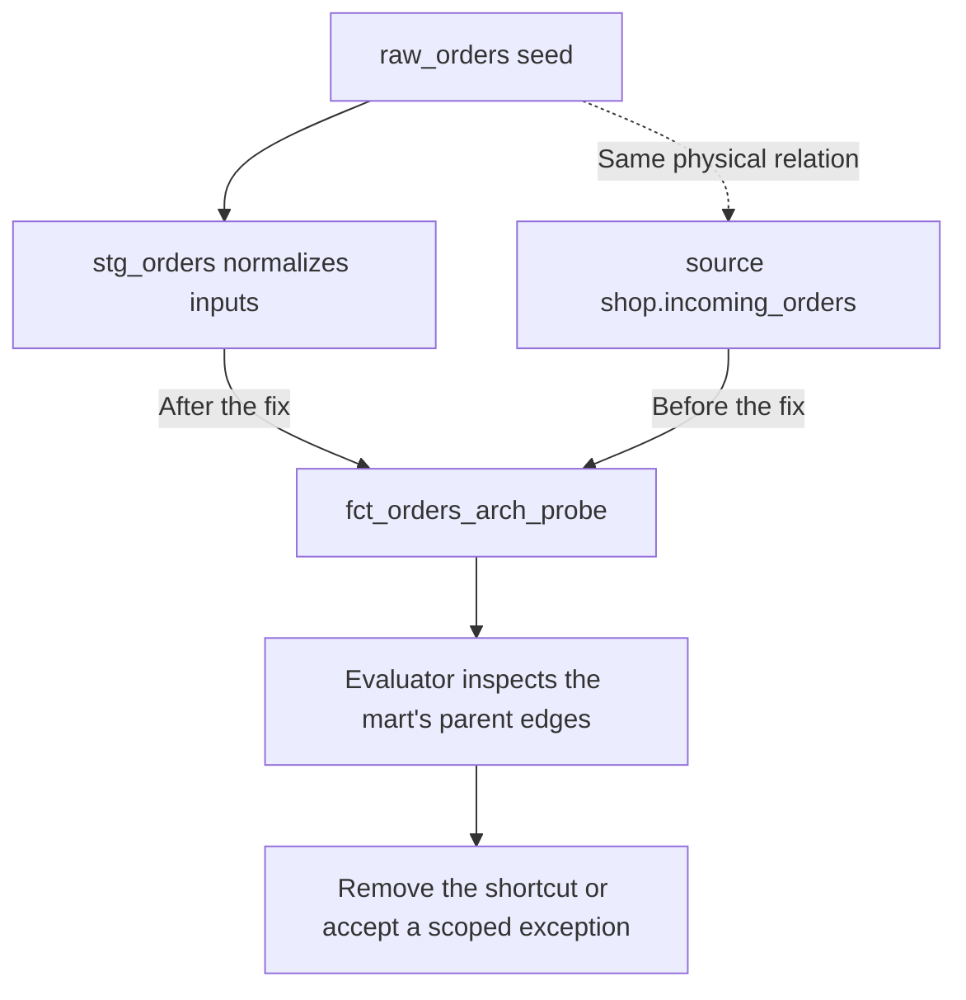

# dbt-project-evaluator and architecture rules

Data tests verify rows, yet a project can pass every `unique` and `not_null` test while slowly turning into spaghetti SQL: marts reading raw sources directly, staging models joining other staging models, or public tables missing primary-key tests. **`dbt-project-evaluator`** audits your DAG metadata against five best-practice categories:

1. **Modeling** catches marts referencing `source()` directly, staging referencing staging, rejoining upstream concepts, unused sources, and root models.
2. **Testing** flags models (especially public/mart models) lacking primary-key tests.
3. **Documentation** catches undocumented models and columns.
4. **Structure and naming** enforces consistent prefixes (`stg_`, `int_`, `fct_`, `dim_`) and directory layout.
5. **Performance** flags excessively long view chains and exposures reading staging instead of marts. [Modeling rules](https://dbt-labs.github.io/dbt-project-evaluator/latest/rules/modeling/)

## v2 native `dbt check` vs Core v1 package builds

| Engine | How the evaluator runs | How exceptions are recorded |
| --- | --- | --- |
| **dbt v2** | Pin a 2.x release compatible with `dbt --version`. `dbt check` evaluates local project metadata with zero warehouse queries (and checks run automatically on `dbt build`). | Configured via the `dbt_project_evaluator_exceptions` variable (or `checks:` severity overrides), naming rule, resource, reason, and owner. |
| **dbt Core v1** | Pin a 1.x release (configure DuckDB `dispatch` search order `[dbt_project_evaluator, dbt]`), run `dbt deps`, then `dbt build --select package:dbt_project_evaluator` in a sandbox and inspect evaluator test tables. | Configured via a `dbt_project_evaluator_exceptions` seed CSV included in the CI run. |

Check the [Package Hub release](https://hub.getdbt.com/dbt-labs/dbt_project_evaluator/latest/) and follow the [v1 setup](https://dbt-labs.github.io/dbt-project-evaluator/1.4/), [v2 setup](https://github.com/dbt-labs/dbt-project-evaluator), or [v2 migration guide](https://dbt-labs.github.io/dbt-project-evaluator/latest/migrating-to-v2/). Roll out rules as warnings first, fix or record scoped exceptions with model owners, and promote rules to `error` once existing debt is clean.



Imagine the loader renames its amount column. In the intended graph, staging maps the new raw name back to `total_cents` and marts keep using their existing interface. Every mart that bypassed staging now needs its own fix. The direct-source rule detects that maintenance cost while the old data still passes row tests.

## Practice with dbt v2 native checks

### What you need

Work in [shop_lab](0004-adapters-profiles-and-the-local-shop-lab.md) with [`stg_orders`](0004-adapters-profiles-and-the-local-shop-lab.md) and [`models/sources.yml`](0007-sources-and-freshness.md) (create the minimal `sources.yml` below if absent).

### Steps

1. Merge `dbt-labs/dbt_project_evaluator` into `packages.yml`:

```yaml
packages:
  - package: dbt-labs/dbt_project_evaluator
    version: 2.0.2
```

2. Ensure `models/sources.yml` declares `shop.incoming_orders`:

```yaml
sources:
  - name: shop
    schema: main
    tables:
      - name: incoming_orders
        identifier: raw_orders
```

3. Deliberately create an architectural shortcut in `models/marts/fct_orders_arch_probe.sql` that bypasses staging to read the raw source:

```sql
select order_id, total_cents
from {{ source('shop', 'incoming_orders') }}
```

4. Install the package and run the specific modeling rule check:

```bash
dbt deps --profiles-dir .
dbt check --profiles-dir . fct_marts_or_intermediate_dependent_on_source
```

**Expected result.** `dbt check` flags a violation linking `fct_orders_arch_probe` directly to `shop.incoming_orders`.

5. Promote that rule to a hard CI failure in `dbt_project.yml` and rerun `dbt check --profiles-dir . fct_marts_or_intermediate_dependent_on_source` to verify a nonzero exit code:

```yaml
checks:
  dbt_project_evaluator:
    modeling:
      fct_marts_or_intermediate_dependent_on_source:
        +severity: error
```

6. **Fix and verify.** Edit `models/marts/fct_orders_arch_probe.sql` to read `{{ ref('stg_orders') }}` instead of `source(...)` and rerun the check. Confirm the violation disappears and the command exits `0`. Run architecture checks across the whole project without `state:` filtering whenever auditing rules or changing severity policies. [Running in CI](https://dbt-labs.github.io/dbt-project-evaluator/latest/ci-check/)

## Recall

1. How can `fct_orders_arch_probe` pass `unique` and `not_null` data tests while still failing `dbt check`?
2. What must a team change when migrating `dbt-project-evaluator` CI checks from Core v1 (1.x) to dbt v2 (2.x)?
3. When a single model legitimately needs an architectural exception, why document it in `dbt_project_evaluator_exceptions` rather than setting `+severity: warn` or disabling the rule project-wide?

??? note "Answer guidance"
    1. Data tests validate row values in the built table, whereas `dbt-project-evaluator` inspects DAG edges and metadata (`manifest.json`), catching direct mart-to-source edges regardless of valid rows.
    2. Replace `dbt build --select package:dbt_project_evaluator` with native `dbt check` commands, move exceptions from the v1 CSV seed into the v2 `dbt_project_evaluator_exceptions` configuration, and declare rule severities under `checks:`.
    3. A scoped exception suppresses only that documented resource with an owner rationale while keeping the rule strictly enforced across every other model in the project.

| Previous | Curriculum | Next |
| --- | --- | --- |
| [Previous lesson](0032-dbt-expectations-for-richer-data-assertions.md) | [All lessons](index.md) | [Next lesson](0034-dbt-codegen-sqlfmt-and-dbt-checkpoint.md) |
