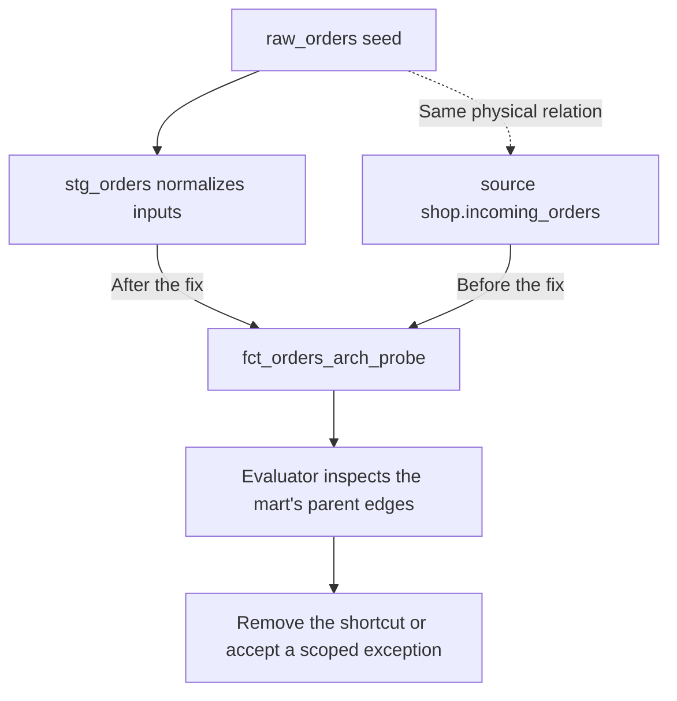

# dbt-project-evaluator and architecture rules

`dbt-project-evaluator` checks the project graph for conventions such as staging boundaries, naming, documentation and test coverage. For example, a mart that reads a source directly bypasses the place where the team normalizes names and types. The check can detect that edge even when all order data tests pass. [Modeling rules](https://dbt-labs.github.io/dbt-project-evaluator/latest/rules/modeling/)

| Engine | Evaluator workflow |
| --- | --- |
| dbt v2 | Use a 2.x release compatible with your `dbt --version`. `dbt check` queries local project metadata without warehouse credentials. The checks also run before `dbt build`. |
| dbt Core v1 | Pin a compatible 1.x release and confirm its adapter list. For DuckDB, configure dispatch for the `dbt` namespace with search order `[dbt_project_evaluator, dbt]`. Run `dbt deps`, then `dbt build --select package:dbt_project_evaluator` in a sandbox. Inspect the rule's warehouse relation or the associated test output. |

Check the [Package Hub release](https://hub.getdbt.com/dbt-labs/dbt_project_evaluator/latest/) and follow the correct [v1 setup](https://dbt-labs.github.io/dbt-project-evaluator/1.4/) or [v2 setup](https://github.com/dbt-labs/dbt-project-evaluator). A v1 CI job may also select the `dbt_project_evaluator_exceptions` seed. In 2.x, exceptions can live in the `dbt_project_evaluator_exceptions` variable. [Migration guide](https://dbt-labs.github.io/dbt-project-evaluator/latest/migrating-to-v2/)

Start with the v2 advisory warnings and review the findings with model owners. For a legitimate exception, record the rule, resource, reason and owner. Promote a rule to an error after addressing existing violations or accepting them explicitly.



## Practice · dbt v2 native checks

In [shop_lab](0004-adapters-profiles-and-the-local-shop-lab.md), add this entry to `packages.yml`.

```yaml
packages:
  - package: dbt-labs/dbt_project_evaluator
    version: 2.0.2
```

Use the [lab's source mapping](0007-sources-and-freshness.md) if you already have it. Otherwise add this minimal declaration in `models/sources.yml`. The seed stands in for the external table.

```yaml
sources:
  - name: shop
    schema: main
    tables:
      - name: incoming_orders
        identifier: raw_orders
```

Save as `models/marts/fct_orders_arch_probe.sql`.

```sql
select order_id, total_cents
from {{ source('shop', 'incoming_orders') }}
```

```bash
dbt deps --profiles-dir .
dbt check --profiles-dir . fct_marts_or_intermediate_dependent_on_source
```

Expect a violation naming the probe mart and `shop.incoming_orders`. To try the CI gate, merge this into `dbt_project.yml` and rerun the same check. Expect a nonzero exit status while the direct edge exists.

```yaml
checks:
  dbt_project_evaluator:
    modeling:
      fct_marts_or_intermediate_dependent_on_source:
        +severity: error
```

Replace the probe's `source()` with `ref('stg_orders')` and rerun. Expect the probe's violation to disappear and the check to exit zero in a clean lab. Re-run the rule without state filtering when changing the rule's policy or auditing the whole project. [Running in CI](https://dbt-labs.github.io/dbt-project-evaluator/latest/ci-check/)

## Recall

1. Why can an architecture violation and a passing `unique` data test coexist?
2. What must a v1 evaluator CI step change when moving to 2.x?

??? success "Answer guidance"
    1. The evaluator checks graph metadata. The data test queries rows and can pass even when a mart reads raw input directly.
    2. Replace the evaluator warehouse build with native checks, move exceptions out of the seed into the supported configuration and set check severity explicitly.

| Previous | Curriculum | Next |
| --- | --- | --- |
| [← Previous lesson](0032-dbt-expectations-for-richer-data-assertions.md) | [All lessons](index.md) | [Next lesson →](0034-dbt-codegen-sqlfmt-and-dbt-checkpoint.md) |
