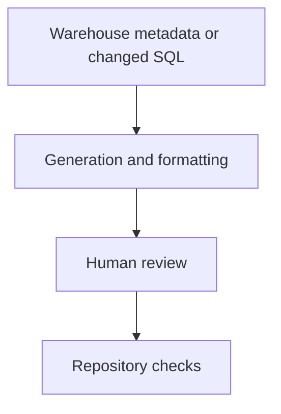

# dbt-codegen, sqlfmt and dbt-checkpoint

`dbt-codegen` generates starter source YAML, model YAML and base SQL from database metadata through macros such as `generate_source` and `generate_model_yaml`. Use generated output as a draft and review types, ownership, tests and grain.

`sqlfmt` formats SQL and Jinja consistently. `dbt-checkpoint` supplies pre-commit hooks for project conventions and can read artifacts for selected checks. Pin hook revisions and ensure checks that need a manifest run after parsing. Mirror key standards in CI because Git hooks run on individual workstations.

## Practice

With compatible releases, generate YAML using `dbt run-operation generate_model_yaml --args '{model_names: [fct_orders]}'`. Review the inferred columns, add domain descriptions and tests, run `sqlfmt --check models/`, then configure one documented dbt-checkpoint hook and run `pre-commit run --all-files`.

## Recall

Which problems are best found by a formatter, a project convention hook, and a warehouse data test?

[dbt-codegen](https://github.com/dbt-labs/dbt-codegen) · [sqlfmt](https://github.com/tconbeer/sqlfmt) · [dbt-checkpoint](https://github.com/dbt-checkpoint/dbt-checkpoint)

| Previous | Curriculum | Next |
| --- | --- | --- |
| [← Previous lesson](0033-dbt-project-evaluator-and-architecture-rules.md) | [All lessons](index.md) | [Next lesson →](0035-dbt-artifacts-and-elementary-observability.md) |
