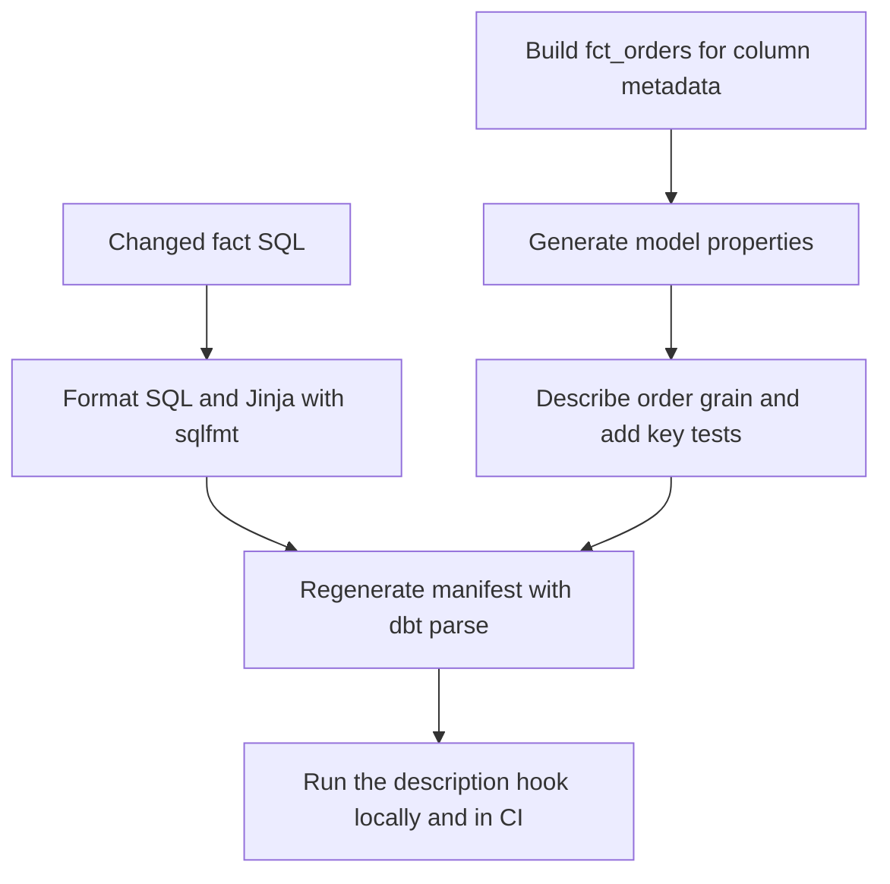

# dbt-codegen, sqlfmt and dbt-checkpoint

Use `dbt-codegen` when you need a starting point for source definitions, staging SQL or model properties. `generate_source` discovers relations in a schema, `generate_base_model` uses a declared source to generate a select, and `generate_model_yaml` reads columns and types from a built model. Copy the generated text into the project after checking grain, ownership, descriptions and tests. Check the release's engine constraints and run the operation against your adapter with a role that can read relation metadata. [dbt-codegen](https://github.com/dbt-labs/dbt-codegen) · [Package Hub release](https://hub.getdbt.com/dbt-labs/codegen/0.14.1/)

`sqlfmt` formats SQL and Jinja files without a warehouse connection. Install the `shandy-sqlfmt` distribution, verify your Python version against the pin, and use the same version and Jinja formatting extras locally and in CI. Review its diff and compile the model to verify dbt still accepts it. [sqlfmt](https://github.com/tconbeer/sqlfmt) · [shandy-sqlfmt release](https://pypi.org/project/shandy-sqlfmt/0.32.0/)

`dbt-checkpoint` runs project policy checks as pre-commit hooks. A description check uses `target/manifest.json`, so regenerate it after changing project files. Read its `metadata.dbt_schema_version` and test a deliberate violation before using the hook as a gate. The exercise uses the v12 manifest emitted by dbt 2.0.12. Run the same check in CI where it can protect merges. [dbt-checkpoint](https://github.com/dbt-checkpoint/dbt-checkpoint) · [Pinned hook definitions](https://github.com/dbt-checkpoint/dbt-checkpoint/blob/v2.0.10/.pre-commit-hooks.yaml)



## Practice with dbt v2, DuckDB, and Python tools

Use [shop_lab](0004-adapters-profiles-and-the-local-shop-lab.md) with the [fct_orders model](0006-models-refs-and-project-configuration.md). Run from the lab root in a scratch Git checkout. Add this to `packages.yml`.

```yaml
packages:
  - package: dbt-labs/codegen
    version: 0.14.1
```

```bash
dbt deps --profiles-dir .
dbt build --profiles-dir . --select +fct_orders
dbt run-operation generate_model_yaml --profiles-dir . --args '{"model_names": ["fct_orders"]}'
```

Expect a draft with five columns, including `total_cents` and `updated_at`. Merge the draft into the existing `fct_orders` properties or create `models/fct_orders.yml`. Give the model a description such as "One row per order, with amounts in cents", and add `unique` and `not_null` tests on `order_id` if missing. Keep any descriptions and tests already in the project.

With Python 3.11 or newer supported by both pins, install into an isolated Python environment. Add extra spaces between `select` and `order_id` in `models/fct_orders.sql` to see the formatter catch the change.

```bash
python -m pip install 'shandy-sqlfmt[jinjafmt]==0.32.0' 'pre-commit==4.7.0'
sqlfmt --check models/fct_orders.sql
sqlfmt models/fct_orders.sql
sqlfmt --check models/fct_orders.sql
```

Expect the first check to exit 1 and the second check to exit 0. Review the resulting diff.

Install the following hook configuration in `.pre-commit-config.yaml`. Stage the fact SQL in the scratch Git checkout so `--all-files` includes it.

```yaml
repos:
  - repo: https://github.com/dbt-checkpoint/dbt-checkpoint
    rev: v2.0.10
    hooks:
      - id: check-model-has-description
        files: '^models/fct_orders\.sql$'
```

```bash
git add models/fct_orders.sql
dbt parse --profiles-dir .
pre-commit run check-model-has-description --all-files
dbt build --profiles-dir . --select +fct_orders
```

Expect the hook to pass and the fact's key tests to pass. Temporarily blank the model description, rerun parse and the hook, and check that it fails naming `fct_orders.sql`. Restore the description, then verify a pass after regenerating the manifest. In CI, run `dbt deps` and `dbt parse` before the hook in the dbt project root.

## Recall

1. Which facts about `fct_orders` need human input after generation?
2. Which tool catches formatting drift, an absent description and duplicate order IDs?

??? success "Answer guidance"
    1. A column listing comes from the relation. The team supplies the business meaning, grain, units and expected guarantees.
    2. sqlfmt catches formatting drift. The dbt-checkpoint hook checks the description. A dbt `unique` data test finds repeated order IDs in the relation.

| Previous | Curriculum | Next |
| --- | --- | --- |
| [Previous lesson](0033-dbt-project-evaluator-and-architecture-rules.md) | [All lessons](index.md) | [Next lesson](0035-dbt-artifacts-and-elementary-observability.md) |
