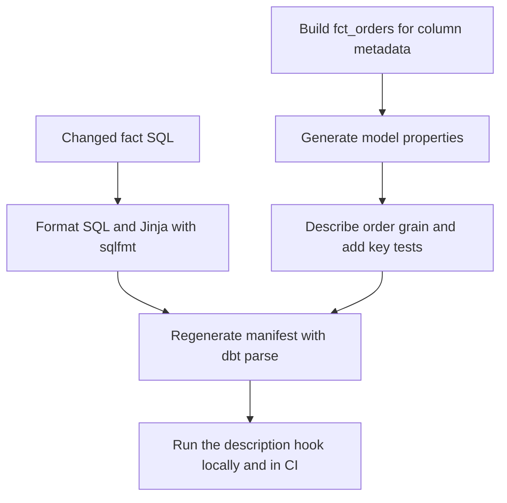

# dbt-codegen, sqlfmt and dbt-checkpoint

Hand-typing YAML column lists and arguing about indentation in pull requests wastes engineering review time. Teams automate project boilerplate, SQL formatting, and repository standards with three complementary tools.

## Comparing `dbt-codegen`, `sqlfmt`, `SQLFluff`, and `dbt-checkpoint`

| Tool | Role in the workflow | Key caveats |
| --- | --- | --- |
| **`dbt-codegen`** | Generates starter YAML/SQL via `dbt run-operation` (`generate_source`, `generate_base_model`, `generate_model_yaml`, `generate_model_import_ctes`). [dbt-codegen](https://github.com/dbt-labs/dbt-codegen) · [Package Hub release](https://hub.getdbt.com/dbt-labs/codegen/0.14.1/) | Inspects warehouse metadata, so build the model first and add human descriptions, grain, and tests to the generated draft. |
| **`sqlfmt`** | Zero-config opinionated formatter for SQL and Jinja (`shandy-sqlfmt[jinjafmt]`). [sqlfmt](https://github.com/tconbeer/sqlfmt) · [shandy-sqlfmt release](https://pypi.org/project/shandy-sqlfmt/0.32.0/) | Formats whitespace and casing consistently with minimal configuration; does not lint SQL logic or aliasing rules (use **SQLFluff** when you need configurable AST linting rules like disallowing `SELECT *` or enforcing CTE conventions). |
| **`dbt-checkpoint`** | Pre-commit and CI policy hooks (`check-model-has-description`, `check-model-has-tests`, `check-model-columns-have-desc`, `check-source-has-freshness`, `check-script-ref-and-source`). [dbt-checkpoint](https://github.com/dbt-checkpoint/dbt-checkpoint) · [Pinned hooks](https://github.com/dbt-checkpoint/dbt-checkpoint/blob/v2.0.10/.pre-commit-hooks.yaml) | Reads `target/manifest.json` (and `target/catalog.json` for some column checks), so you **must** rerun `dbt parse` after editing YAML or SQL before running hooks! |



Verify Python version pins and `manifest.json` schema compatibility (`metadata.dbt_schema_version`, v12 on dbt 2.0.12) across local machines and CI runners, and test every new hook with an intentional violation before making it required.

Review the description that code generation cannot infer: “One row per order, including pending orders. Amounts are in cents.” A description hook can catch an empty field, yet it would also accept “Order data.” Have a reviewer use the description to predict what summing `total_cents` across all rows means.

## Practice with dbt v2, DuckDB, and Python tools

### What you need

Work in a **scratch Git checkout** of [shop_lab](0004-adapters-profiles-and-the-local-shop-lab.md) with [`fct_orders`](0006-models-refs-and-project-configuration.md), plus Python 3.11+ in a virtual environment.

### Steps

1. Merge `dbt-labs/codegen` into `packages.yml`, install it, build `fct_orders`, and generate a YAML draft:

```yaml
packages:
  - package: dbt-labs/codegen
    version: 0.14.1
```

```bash
dbt deps --profiles-dir .
dbt build --profiles-dir . --select +fct_orders
dbt run-operation generate_model_yaml --profiles-dir . --args '{"model_names": ["fct_orders"]}'
```

Confirm the printed draft includes all 5 columns (`order_id`, `customer_id`, `status`, `total_cents`, `updated_at`). Merge any missing column entries into `models/fct_orders.yml` while keeping your grain description ("One row per order, with amounts in cents") and `order_id` tests (`unique`, `not_null`).

2. Install `sqlfmt` and `pre-commit` in your isolated Python environment, then insert extra spaces between `select` and `order_id` in `models/fct_orders.sql` and test formatting:

```bash
python -m pip install 'shandy-sqlfmt[jinjafmt]==0.32.0' 'pre-commit==4.7.0'
sqlfmt --check models/fct_orders.sql
sqlfmt models/fct_orders.sql
sqlfmt --check models/fct_orders.sql
```

**Expected result.** The first `sqlfmt --check` exits `1`, `sqlfmt` reformats the spacing cleanly, and the second check exits `0`.

3. Create `.pre-commit-config.yaml` in the root of your scratch Git checkout and stage `models/fct_orders.sql` so `pre-commit` scans it:

```yaml
repos:
  - repo: https://github.com/dbt-checkpoint/dbt-checkpoint
    rev: v2.0.10
    hooks:
      - id: check-model-has-description
        files: '^models/fct_orders\.sql$'
```

```bash
git add models/fct_orders.sql
dbt parse --profiles-dir .
pre-commit run check-model-has-description --all-files
dbt build --profiles-dir . --select +fct_orders
```

**Expected result.** The hook exits `0` and the build passes. Now temporarily blank out `description:` on `fct_orders` in `models/fct_orders.yml`, run `dbt parse --profiles-dir .`, and rerun `pre-commit run check-model-has-description --all-files`. Confirm the hook fails and names `fct_orders.sql`. Restore the description, re-run `dbt parse --profiles-dir .`, and confirm a pass. In CI, always run `dbt deps` and `dbt parse` before `dbt-checkpoint`.

## Recall

1. After `generate_model_yaml` prints a YAML template for `fct_orders`, which information still requires human input before merging?
2. Match each tool (`sqlfmt`, `dbt-checkpoint`, `unique` data test) to the failure it catches: blank model description, inconsistent SQL indentation, duplicate `order_id` rows.
3. Why can `dbt-checkpoint` wrongly pass or fail locally right after you edit a YAML description, and how does `sqlfmt` differ from `SQLFluff`?

??? note "Answer guidance"
    1. Codegen extracts column names and types from the table, whereas engineers must supply business descriptions, explicit grain, currency units, and domain tests (`unique`, `not_null`, `accepted_values`).
    2. `sqlfmt` catches inconsistent SQL/Jinja formatting, `dbt-checkpoint` (`check-model-has-description`) catches blank/missing model descriptions, and the `unique` data test catches duplicate `order_id` rows in DuckDB.
    3. `dbt-checkpoint` reads `target/manifest.json` rather than raw YAML directly, so you must run `dbt parse` after editing YAML. `sqlfmt` is an opinionated zero-config code formatter, whereas `SQLFluff` is a configurable SQL linter + formatter that enforces dialect, aliasing, and style rules.

| Previous | Curriculum | Next |
| --- | --- | --- |
| [Previous lesson](0033-dbt-project-evaluator-and-architecture-rules.md) | [All lessons](index.md) | [Next lesson](0035-dbt-artifacts-and-elementary-observability.md) |
