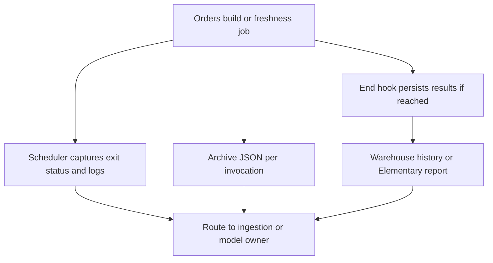

# dbt-artifacts and Elementary observability

Preserve `manifest.json` for graph context, `run_results.json` for node statuses and timings, and `sources.json` for results from `dbt source freshness`. The v2 `dbt freshness` command also writes `freshness.json` for sources and models. Archive files and scheduler logs per invocation because subsequent commands can replace the files in `target/`. Check `metadata.dbt_schema_version` before consuming an artifact. Match a result's `unique_id` to a node in the manifest from the same run. [dbt artifacts reference](https://docs.getdbt.com/reference/artifacts/dbt-artifacts)



## Choose a warehouse collector

**dbt-artifacts · supported warehouse, such as Core v1 with PostgreSQL.** `brooklyn-data/dbt_artifacts` builds a metadata mart from dbt's runtime results. Its upload hook works with the `results` context. Confirm the release's range, tested engine and adapter before enabling the hook. Release 2.11.1 declares dbt `>=1.3.0, <3.0.0`. The maintainers' Core CI starts at 1.9, and the Hub v2 badge for this release is based on the declared range. DuckDB is absent from the supported warehouse list. [dbt-artifacts](https://github.com/brooklyn-data/dbt_artifacts) · [Package Hub](https://hub.getdbt.com/brooklyn-data/dbt_artifacts/latest/)

In a supported sandbox with permission to build and write the telemetry tables, pin `brooklyn-data/dbt_artifacts` to `2.11.1` in `packages.yml`. Set up a sandbox profile target named `telemetry_dev`. Run `dbt deps` and `dbt run --target telemetry_dev --select dbt_artifacts` to initialize its relations. Then merge this hook into `dbt_project.yml`.

```yaml
on-run-end:
  - "{{ dbt_artifacts.upload_results(results) }}"
```

Run `dbt build --target telemetry_dev --select +fct_orders` with the order test below. Inspect `fct_dbt__invocations`, `fct_dbt__model_executions` and `fct_dbt__test_executions` in the configured schema. Confirm that the new invocation has a model execution for `fct_orders` and a result for the selected test. Rebuild the package relations when upgrading to a release with new columns.

**Elementary · supported engine and adapter pair.** The `elementary-data/elementary` package persists dbt metadata and test results and adds tests such as `elementary.volume_anomalies`. The OSS CLI reads those tables for reports and alerts. Elementary Cloud is a separate managed workflow. Verify the package, CLI, Python and adapter together. The maintainer documents v2 integration as beta. In the local dbt 2.0.12 DuckDB lab, Elementary 0.26.1 resolves but its metadata build fails on temporary tables. Use the local JSON exercise below, or try the package in a supported setup such as Core v1 with PostgreSQL. [Elementary](https://docs.elementary-data.com/home) · [v2 integration](https://docs.elementary-data.com/oss/integrations/dbt-fusion) · [Release matrix and changes](https://github.com/elementary-data/dbt-data-reliability/releases)

1. Pin `elementary-data/elementary` to `0.26.1` in `packages.yml`. Under `models:` in `dbt_project.yml`, set `elementary: {+schema: elementary}`. Follow the package quickstart for the test materialization override for your engine and adapter. Run `dbt deps`, then `dbt run --select elementary` to create the telemetry tables. [Elementary package quickstart](https://docs.elementary-data.com/oss/quickstart/quickstart-cli-package)
2. In a compatible sandbox, run the order test below and check `elementary_test_results` for the matching invocation and status. To try a volume anomaly check on data with recent history, attach this model-level test to `fct_orders`. Completed daily buckets are compared with historical counts. Use a timestamp that matches the volume you want to measure. The three dated shop rows are useful for a deterministic assertion and too sparse to validate a baseline. [Volume anomalies](https://docs.elementary-data.com/data-tests/anomaly-detection-tests/volume-anomalies)

    ```yaml
    data_tests:
      - elementary.volume_anomalies:
          arguments:
            timestamp_column: updated_at
            time_bucket: {period: day, count: 1}
          config:
            severity: warn
    ```

3. In an isolated Python environment, install a compatible CLI release with the documented adapter extra for Core v1, for example `elementary-data[dbt1-postgres]`. For v2 use the base CLI alongside the v2 distribution. Generate the reader profile with `dbt run-operation elementary.generate_elementary_cli_profile`, point it at the telemetry schema, then run `edr report --select last_invocation` and find the order test in the HTML report. Configure owner routing and suppression before scheduling alerts. [Elementary CLI setup](https://docs.elementary-data.com/oss/quickstart/quickstart-cli) · [Elementary report](https://docs.elementary-data.com/oss/quickstart/quickstart-report) · [Elementary alerts](https://docs.elementary-data.com/oss/quickstart/quickstart-alerts)

Compare the collectors' overlap before enabling both. Set retention and restrict access to telemetry tables and reports that contain project metadata or sampled test rows.

## Practice with local dbt v2 and DuckDB

Start in a fresh [shop_lab](0004-adapters-profiles-and-the-local-shop-lab.md) with [fct_orders](0006-models-refs-and-project-configuration.md). Save as `tests/no_negative_order_amounts.sql`.

```sql
select order_id, total_cents
from {{ ref('fct_orders') }}
where total_cents < 0
```

```bash
mkdir -p evidence/clean evidence/failed
dbt build --profiles-dir . --select +fct_orders
cp target/{manifest,run_results}.json evidence/clean/
```

For a failure drill, temporarily replace the test predicate with `where order_id = 1` to simulate one violating row. Rerun the build, expect a nonzero exit status, and copy the new files with `cp target/{manifest,run_results}.json evidence/failed/`. Restore the predicate. Compare the two saved invocations with Python 3.

```python
import json
from pathlib import Path

for label in ("clean", "failed"):
    root = Path("evidence") / label
    manifest = json.loads((root / "manifest.json").read_text())
    run = json.loads((root / "run_results.json").read_text())
    invocation = run["metadata"]["invocation_id"]
    assert invocation == manifest["metadata"]["invocation_id"]
    node_id = "test.shop_lab.no_negative_order_amounts"
    result = next(row for row in run["results"] if row["unique_id"] == node_id)
    print(label, invocation, manifest["nodes"][node_id]["original_file_path"], result["status"])
```

Expect distinct invocation IDs, the same test file path and statuses `pass` and `fail`. For a second signal, use the [freshness exercise](0007-sources-and-freshness.md) and inspect `target/sources.json` for `shop.incoming_orders`. Its fixed timestamp is stale outside the fixture window. Route a freshness breach to the ingestion owner and the failed order test to the model owner. Use the invocation ID and node ID to deduplicate repeated delivery for the same run. A retry has a new invocation ID, so use the scheduler's logical run ID if it should share an incident.

## Recall

1. Why might a failed job be missing from the warehouse telemetry mart?
2. Which evidence tells you that orders arrived late, and which tells you their totals broke a rule?

??? success "Answer guidance"
    1. Parse errors, process termination and connection failures can prevent the hook from running or writing. Consult the scheduler's exit status and logs.
    2. Source freshness reports staleness against its threshold. The order test reports whether any selected rows violate the amount rule.

| Previous | Curriculum | Next |
| --- | --- | --- |
| [Previous lesson](0034-dbt-codegen-sqlfmt-and-dbt-checkpoint.md) | [All lessons](index.md) | [Next lesson](0036-dbt-copilot-wizard-and-reviewed-ai-changes.md) |
