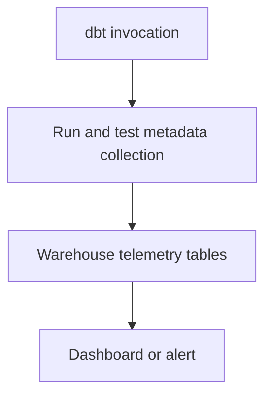

# dbt-artifacts and Elementary observability

The community package `brooklyn-data/dbt_artifacts` models dbt metadata in the warehouse and documents collection with an on-run-end hook. Use persisted invocation and node records to compare failures, runtimes and adoption across runs. Choose retention and access policies for those records.

Elementary offers a dbt package for data quality tests and warehouse-side metadata and observability. Its OSS and managed offerings differ in configuration and features. Compare artifact persistence, anomaly tests, reporting and alerting before installing both tools. Preserve independent scheduler logs because some failures prevent in-project collection.

## Practice

Design telemetry for a freshness breach and a failing data test. Specify what lands in the warehouse, what alerts the on-call owner, and how an invocation ID prevents multiple notifications for one run.

## Recall

Which failure modes could prevent a hook-based collector from recording the run?

[dbt-artifacts](https://github.com/brooklyn-data/dbt_artifacts) · [Elementary documentation](https://docs.elementary-data.com/home)

| Previous | Curriculum | Next |
| --- | --- | --- |
| [← Previous lesson](0034-dbt-codegen-sqlfmt-and-dbt-checkpoint.md) | [All lessons](index.md) | [Next lesson →](0036-dbt-copilot-wizard-and-reviewed-ai-changes.md) |
