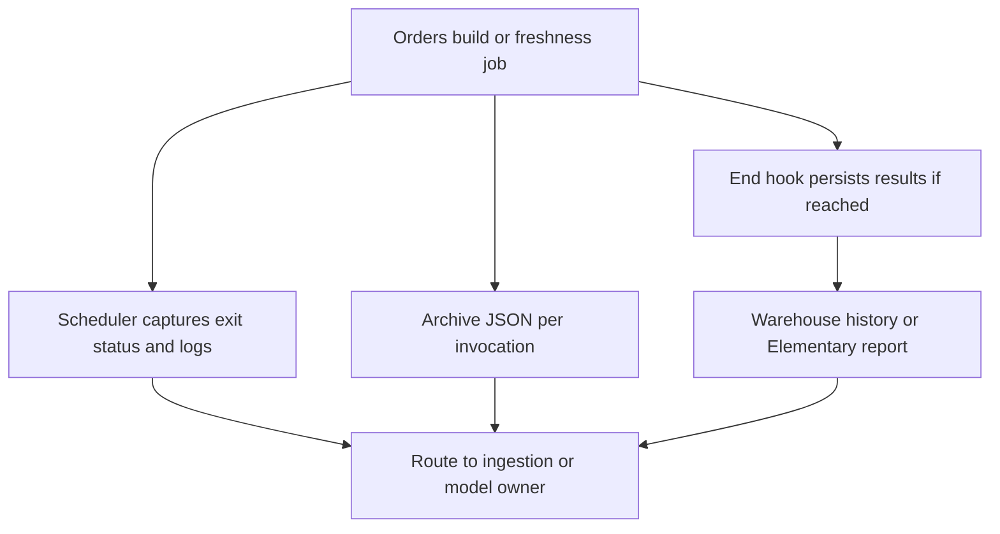

# dbt-artifacts and Elementary observability

A single failing test email tells you what broke today, not whether `fct_orders` runtime tripled over the last month or row volumes dropped 40% overnight. **dbt observability** stores run history and data metrics over time across four pillars:

1. **Execution telemetry.** Invocation success rates, skipped nodes, and model duration trends (`dbt_artifacts`, Elementary).
2. **Freshness and volume anomalies.** Comparing source arrival times and daily row counts against historical baselines (`dbt source freshness`, `elementary.volume_anomalies`).
3. **Schema drift and distribution shifts.** Detecting added/dropped columns or anomalous nulls (`schema_changes`, `column_anomalies`).
4. **Alert routing and deduplication.** Sending freshness breaches to ingestion owners and model failures to transformation owners without spamming duplicate alerts on retries.

Preserve `manifest.json` (graph), `run_results.json` (outcomes and timings), and `sources.json` / v2 `freshness.json` (source/model freshness) per invocation before subsequent commands overwrite `target/`. Match `unique_id` values using files with identical `metadata.invocation_id` and check `metadata.dbt_schema_version`. [dbt artifacts reference](https://docs.getdbt.com/reference/artifacts/dbt-artifacts)



Remember that `on-run-end` hooks never execute if a job crashes during YAML parsing, profile connection, or container OOM, so always pair warehouse telemetry hooks with scheduler exit status checks and logs!

## Choosing a warehouse collector

- **Option A · `dbt-artifacts` (supported warehouse such as Core v1 with PostgreSQL).** `brooklyn-data/dbt_artifacts` builds metadata marts (`fct_dbt__invocations`, `fct_dbt__model_executions`, `fct_dbt__test_executions`) via an `on-run-end` upload hook. Release `2.11.1` declares dbt `>=1.3.0, <3.0.0` (maintainers' Core CI starts at 1.9; Hub's v2 badge reflects the declared range, and DuckDB is excluded from supported warehouses). In a supported sandbox, pin `2.11.1`, run `dbt deps` and `dbt run --target telemetry_dev --select dbt_artifacts`, merge the hook below into `dbt_project.yml`, build `+fct_orders`, and verify rows in the telemetry tables (rebuild package models when upgrading schemas): [dbt-artifacts](https://github.com/brooklyn-data/dbt_artifacts) · [Package Hub](https://hub.getdbt.com/brooklyn-data/dbt_artifacts/latest/)

```yaml
on-run-end:
  - "{{ dbt_artifacts.upload_results(results) }}"
```

- **Option B · Elementary (supported engine and adapter pair).** `elementary-data/elementary` stores metadata and adds anomaly tests (`elementary.volume_anomalies`), paired with the `edr` CLI for HTML reports (`edr report --select last_invocation`) and alerts. Maintainability note: Elementary documents v2 integration as beta, and in the local dbt 2.0.12 DuckDB lab, Elementary `0.26.1` resolves via `dbt deps` yet fails building metadata on temporary tables. Run the local JSON drill below on DuckDB, or test Elementary on a supported pair such as Core v1 with PostgreSQL. [Elementary](https://docs.elementary-data.com/home) · [v2 integration](https://docs.elementary-data.com/oss/integrations/dbt-fusion) · [Releases](https://github.com/elementary-data/dbt-data-reliability/releases)

  1. On a supported warehouse, pin `elementary-data/elementary` `0.26.1` in `packages.yml`, set `models: {elementary: {+schema: elementary}}`, follow the adapter's test materialization guide, and initialize with `dbt deps` + `dbt run --select elementary`. [Elementary package quickstart](https://docs.elementary-data.com/oss/quickstart/quickstart-cli-package)
  2. Attach `volume_anomalies` to `fct_orders` (requires multi-day historical volume beyond the 3-row starter seed for meaningful baselines) and check `elementary_test_results`: [Volume anomalies](https://docs.elementary-data.com/data-tests/anomaly-detection-tests/volume-anomalies)

```yaml
    data_tests:
      - elementary.volume_anomalies:
          arguments:
            timestamp_column: updated_at
            time_bucket: {period: day, count: 1}
          config:
            severity: warn
```

  3. Install a matching CLI (`elementary-data[dbt1-postgres]` for Core v1 or base CLI for v2), generate the reader profile with `dbt run-operation elementary.generate_elementary_cli_profile`, run `edr report --select last_invocation`, and configure owner alert suppression before enabling notifications. [Elementary CLI setup](https://docs.elementary-data.com/oss/quickstart/quickstart-cli) · [Report](https://docs.elementary-data.com/oss/quickstart/quickstart-report) · [Alerts](https://docs.elementary-data.com/oss/quickstart/quickstart-alerts)

Compare overlap before running both `dbt-artifacts` and Elementary together, and restrict access to telemetry tables/reports that expose compiled SQL or sample failing rows.

Try correlating a failed scheduled run and its successful retry. Both attempts target the same orders batch and test node. Give each attempt its own invocation ID and attach both to the same incident. When a new batch fails tomorrow, its batch or scheduler run ID should open a separate incident even if the test name repeats.

## Practice with local dbt v2 and DuckDB

### What you need

Start in a fresh [shop_lab](0004-adapters-profiles-and-the-local-shop-lab.md) with [`fct_orders`](0006-models-refs-and-project-configuration.md).

### Steps

1. Save a non-negative amount check in `tests/no_negative_order_amounts.sql`:

```sql
select order_id, total_cents
from {{ ref('fct_orders') }}
where total_cents < 0
```

2. Run a clean build and archive its artifacts under `evidence/clean/`:

```bash
mkdir -p evidence/clean evidence/failed
dbt build --profiles-dir . --select +fct_orders
cp target/{manifest,run_results}.json evidence/clean/
```

3. Temporarily break the test predicate to `where order_id = 1`, run `dbt build --profiles-dir . --select +fct_orders` (expect nonzero exit), copy `target/{manifest,run_results}.json` into `evidence/failed/`, and restore `where total_cents < 0`.
4. Run Python 3 to verify invocation alignment and compare both test outcomes:

```python
import json
from pathlib import Path

for label in ("clean", "failed"):
    root = Path("evidence") / label
    manifest = json.loads((root / "manifest.json").read_text())
    run = json.loads((root / "run_results.json").read_text())
    invocation = run["metadata"]["invocation_id"]
    assert invocation == manifest["metadata"]["invocation_id"]
    node_id = "test.shop_lab.no_negative_order_amounts"
    result = next(row for row in run["results"] if row["unique_id"] == node_id)
    print(label, invocation, manifest["nodes"][node_id]["original_file_path"], result["status"])
```

**Expected result.** Python prints distinct `invocation_id` values, the same test file path, and statuses `pass` and `fail`. Pair this with [lesson 0007](0007-sources-and-freshness.md) (`target/sources.json` for `shop.incoming_orders`), routing source freshness alerts to the ingestion owner and test failures to the model owner.

## Recall

1. Why might a catastrophic dbt job failure never show up in `fct_dbt__invocations` or `elementary_test_results`?
2. Which evidence shows that raw orders arrived late from ingestion, and which shows that built rows violated a business rule?
3. When deduplicating incident alerts across retries of the same scheduled job, why should you key incidents by the scheduler's logical run ID rather than dbt's `invocation_id`?

??? note "Answer guidance"
    1. Parse failures, `profiles.yml` connection errors, and container kills happen before or bypass `on-run-end` hooks, so you must also monitor scheduler exit codes and logs.
    2. `sources.json` (or `freshness.json` in v2) measures source load age against thresholds, whereas `run_results.json` test results report failing rows in transformed models.
    3. Every `dbt retry` or rerun generates a brand-new `invocation_id`; keying by the scheduler's logical job run ID groups retries under the same open incident instead of paging twice.

| Previous | Curriculum | Next |
| --- | --- | --- |
| [Previous lesson](0034-dbt-codegen-sqlfmt-and-dbt-checkpoint.md) | [All lessons](index.md) | [Next lesson](0036-dbt-copilot-wizard-and-reviewed-ai-changes.md) |
