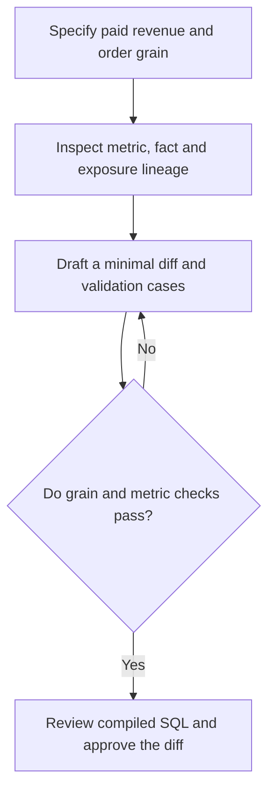

# dbt Copilot, Wizard and reviewed AI changes

Use AI to draft a change and ask for evidence a reviewer can reproduce. dbt Copilot generated SQL, tests, documentation and semantic models inside the platform. As of November 19, 2026, dbt Labs no longer sells or enables Copilot for new accounts. Existing customers can still use it. dbt Wizard is the recommended agent for multi-step work in Studio and in local Desktop and CLI workflows. Check the current preview status, account settings and usage terms for your surface. [Copilot](https://docs.getdbt.com/docs/dbt-ai/copilot-overview) · [Wizard](https://docs.getdbt.com/docs/platform/wizard-overview)

Wizard uses the dbt Information Schema for context such as upstream dependencies, tests and metric definitions. Start by asking it to identify the metric's owning model and downstream exposure, then request a diff and validation commands. Work on a development branch with a sandbox target. Share the model schema and synthetic cases, and keep credentials and sensitive records out of prompts. Review any command that writes data and verify its target before running it.



## Practice

Use the original [shop_lab fixture](0004-adapters-profiles-and-the-local-shop-lab.md) and its [order fact](0006-models-refs-and-project-configuration.md). Ask Wizard to propose a patch to the existing [metric definitions](0027-metrics-time-spine-and-downstream-integrations.md). Give it these acceptance criteria:

> Keep one row per order in `fct_orders`. Keep all statuses in `order_total_cents`. Count only paid orders in `paid_revenue_cents`. Show the proposed metric diff, name its dashboard consumer, and supply a regression case with a pending order.

For a manual review, treat the SQL below as the proposed implementation. It compiles and can leave every fact test green.

```bash
dbt build --profiles-dir . --select +fct_orders
dbt show --profiles-dir . --inline "
select
    count(*) as orders,
    count(distinct order_id) as distinct_orders,
    sum(total_cents) as order_total_cents,
    sum(total_cents) as paid_revenue_cents
from {{ ref('fct_orders') }}"
```

Check the SQL or metric diff for join fanout, misplaced filters and changes to unrelated definitions. Fix the paid aggregation and run it again. Your review passes when all three order IDs remain, the total remains **3,500**, and paid revenue falls from **3,500** to **3,000** cents. Keep the pending 500-cent order as the regression case and name `orders_dashboard` in the review. For an extra edge case, predict what a fixture containing only pending rows should return for paid revenue.

[Unit tests](https://docs.getdbt.com/docs/build/unit-tests) · [Metric definitions](https://docs.getdbt.com/reference/semantic-layer-reference)

## Recall

1. How can a generated change compile and pass the fact tests while overstating revenue?
2. Where should the paid filter live if consumers also need all-order totals?

??? note "Answer guidance"

    1. Both expressions are valid SQL. A key or status test checks properties of fact rows and can pass while the paid metric includes the pending 500 cents.
    2. Apply the condition inside the paid aggregation, for example `sum(case when status = 'paid' then total_cents else 0 end)`. The fact keeps all statuses and the all-pending fixture yields zero paid cents.

| Previous | Curriculum | Next |
| --- | --- | --- |
| [← Previous lesson](0035-dbt-artifacts-and-elementary-observability.md) | [All lessons](index.md) | [Next lesson →](0037-dbt-state-and-freshness-aware-orchestration.md) |
