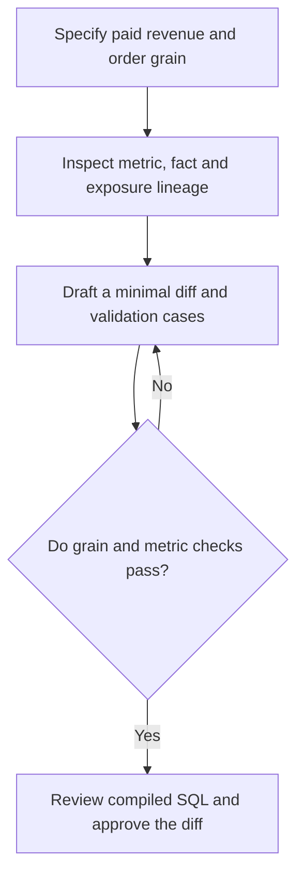

# dbt Copilot, Wizard and reviewed AI changes

AI assistants can draft dbt models, YAML tests, descriptions, and semantic definitions quickly, yet generated SQL that compiles cleanly can still silently break business grain or revenue totals. Treat AI output exactly like an unreviewed pull request: ground prompts with explicit constraints and verify every change against real tests and reconciliations.

**dbt Copilot** generated SQL, tests, documentation, and semantic models inside the platform. As of November 19, 2026, dbt Labs no longer sells or enables Copilot for new accounts (existing customers retain access). **dbt Wizard** is the active agent for multi-step development in Studio and in local Desktop and CLI workflows. Verify current preview status, account settings, and usage terms for your environment. [Copilot](https://docs.getdbt.com/docs/dbt-ai/copilot-overview) · [Wizard](https://docs.getdbt.com/docs/platform/wizard-overview)

## Grounding prompts and reviewing AI diffs

dbt Wizard reads the dbt Information Schema for upstream dependencies, tests, and metric definitions. Start by having it locate the owning model and downstream exposures, then request a minimal diff and runnable verification commands. Work on a feature branch targeting a sandbox schema, share only schema and synthetic sample data (never credentials or sensitive customer rows), and inspect every write command before executing it.



Use this four-point review checklist on any AI-generated dbt PR:

1. **Dependencies.** Verify `ref()` and `source()` calls replaced any hardcoded warehouse table names.
2. **Join direction and grain.** Confirm lookup joins cannot fan out rows and primary-key `unique` + `not_null` tests remain intact.
3. **Filter placement.** Check whether filters belong in a model `WHERE` clause (dropping rows for everyone) or inside conditional metric logic (preserving all-order facts).
4. **Reproducible proof.** Require `dbt compile`, `dbt build`, a synthetic edge-case check (such as a [unit test](0013-unit-tests-and-edge-cases.md)), and row/aggregate reconciliation.

## Practice

### What you need

Use the original [shop_lab fixture](0004-adapters-profiles-and-the-local-shop-lab.md) and [`fct_orders`](0006-models-refs-and-project-configuration.md).

### Steps

1. Ask Wizard (or draft manually) to propose a patch to the [metric definitions](0027-metrics-time-spine-and-downstream-integrations.md) using these acceptance criteria:

> Keep one row per order in `fct_orders`. Keep all statuses in `order_total_cents`. Count only paid orders in `paid_revenue_cents`. Show the proposed metric diff, name its dashboard consumer, and supply a regression case with a pending order.

2. Treat the query below as an AI-proposed implementation. Notice it compiles cleanly and leaves all fact tests green, yet contains a revenue bug:

```bash
dbt build --profiles-dir . --select +fct_orders
dbt show --profiles-dir . --inline "
select
    count(*) as orders,
    count(distinct order_id) as distinct_orders,
    sum(total_cents) as order_total_cents,
    sum(total_cents) as paid_revenue_cents
from {{ ref('fct_orders') }}"
```

3. Spot the missing filter, fix `paid_revenue_cents` to `sum(case when status = 'paid' then total_cents else 0 end)`, and rerun the preview.
4. **Expected result.** `orders` and `distinct_orders` stay **3**, `order_total_cents` stays **3,500**, and `paid_revenue_cents` corrects from **3,500** down to **3,000**. Name `orders_dashboard` as the impacted exposure, keep the 500-cent pending order as your regression case, and predict what a synthetic fixture containing *only* pending rows should return (`0` paid cents). [Unit tests](https://docs.getdbt.com/docs/build/unit-tests) · [Metric definitions](https://docs.getdbt.com/reference/semantic-layer-reference)

## Recall

1. How can an AI-generated change pass `dbt compile` and every table key test while overstating paid revenue by 500 cents?
2. Where must the `status = 'paid'` filter live if downstream dashboards also query `order_total_cents` from `fct_orders`?
3. Besides revenue filter bugs, name two other defects to check when reviewing an AI-generated dbt model PR.

??? note "Answer guidance"
    1. Both `sum(total_cents)` and the conditional sum are valid SQL and preserve one row per `order_id`. Uniqueness and status tests check table rows, not metric aggregation rules.
    2. Put the condition inside the `paid_revenue_cents` aggregation (`sum(case when status = 'paid' then total_cents else 0 end)` or a metric filter), leaving `fct_orders` unfiltered for all-order metrics. An all-pending unit fixture should then yield `0` paid cents.
    3. Check for hardcoded table names bypassing `ref()`/`source()`, `INNER` joins or unaggregated child joins causing fanout, wrong timestamp columns (such as `updated_at` vs `paid_at`), and sensitive PII or secrets pasted into prompts.

| Previous | Curriculum | Next |
| --- | --- | --- |
| [Previous lesson](0035-dbt-artifacts-and-elementary-observability.md) | [All lessons](index.md) | [Next lesson](0037-dbt-state-and-freshness-aware-orchestration.md) |
