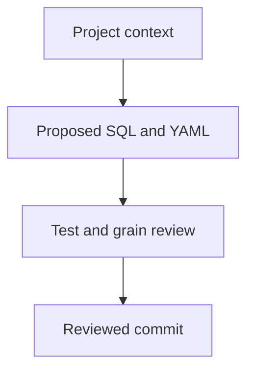

# dbt Copilot, Wizard and reviewed AI changes

dbt Copilot offered in-platform generation of SQL, tests, documentation and semantic models. As of November 19, 2026, dbt Labs no longer enables Copilot for new platform accounts. Existing customers can continue using it. dbt Wizard is the documented successor for agentic work in Studio, desktop and terminal workflows, subject to account availability.

Keep credentials and sensitive rows out of prompts. Review generated diffs for incorrect assumptions about grain, filters, joins, or metric denominators. Validate the change using the same project checks you would require from a person.

## Practice

Ask for a change proposal that excludes unpaid orders from revenue. Review its generated SQL or YAML and add an edge case the proposal missed. Without AI access, review a deliberately flawed variant that includes pending orders.

## Recall

Why can a generated model pass syntax checks while reporting inflated revenue?

[Copilot](https://docs.getdbt.com/docs/dbt-ai/copilot-overview) · [Wizard](https://docs.getdbt.com/docs/platform/wizard-overview)

| Previous | Curriculum | Next |
| --- | --- | --- |
| [← Previous lesson](0035-dbt-artifacts-and-elementary-observability.md) | [All lessons](index.md) | [Next lesson →](0037-dbt-state-and-freshness-aware-orchestration.md) |
