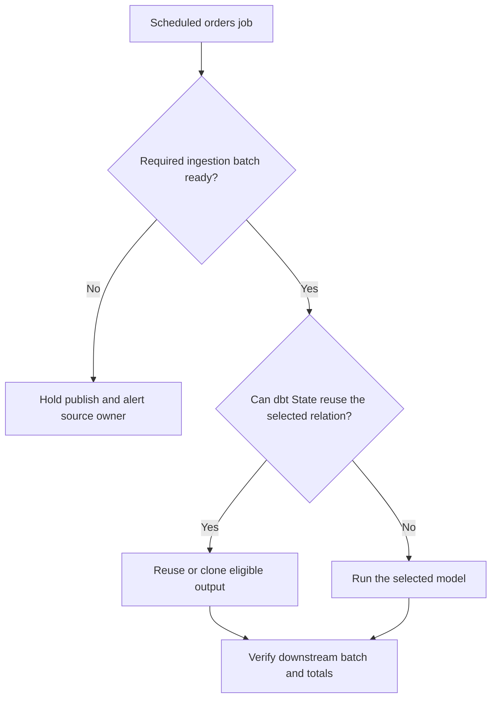

# dbt State and freshness-aware orchestration

| Mechanism | Decision |
| --- | --- |
| Manifest comparison with `--state baseline --select state:modified+` | Select project resources changed since a saved manifest and their descendants. A warehouse-only update leaves this comparison unchanged. |
| dbt State | Within the requested selection, compare transformation logic, configuration, relation state and upstream freshness. Reuse an eligible relation, clone where supported, or build when reuse is unsafe. |
| Source freshness | Compare the observed source load time with an age threshold. Use the result to alert or gate a job when ingestion is late. |

dbt State can observe data changes through warehouse metadata or configured source freshness signals. `config.state.lag_tolerance` sets the lag a model can tolerate before a detected upstream change makes it due for a rebuild. For example, use `2h` for a model whose consumers can wait two hours between data-driven builds. `config.state.require_fresh_data_from` can require fresh data from `any` or `all` direct parents. Choose `all` when inputs must arrive together, and keep a separate ingestion deadline so a missing batch generates an alert. The older platform **State-aware orchestration** uses `freshness.build_after`. The two job toggles are mutually exclusive, and existing jobs may need explicit reconfiguration even after enabling dbt State on their environment. [About dbt State](https://docs.getdbt.com/docs/deploy/dbt-state-about) · [Migration guide](https://docs.getdbt.com/docs/deploy/dbt-state-migration) · [Enabling dbt State on environments and jobs](https://docs.getdbt.com/docs/deploy/dbt-state-enable-env-jobs)

!!! note "Runtime and adapter support"

    dbt State requires a dbt account, including for self-managed use. It is built into dbt v2 and v1.13, with a plugin available for v1.7 through v1.12. Check supported warehouses before piloting. DuckDB supports this lesson's local manifest exercise. [dbt State setup](https://docs.getdbt.com/docs/deploy/dbt-state-setup)



## Practice

Use a disposable copy of [shop_lab](0004-adapters-profiles-and-the-local-shop-lab.md) with [`fct_orders`](0006-models-refs-and-project-configuration.md) and the original fixture. Save a baseline outside `target/`. Simulate an ingestion write directly in DuckDB with `run-operation`, keeping the seed CSV and model code unchanged.

```bash
dbt build --profiles-dir . --select +fct_orders
mkdir -p baseline
cp target/manifest.json baseline/manifest.json

dbt run-operation run_query --profiles-dir . --args \
  "sql: update main.raw_orders set status = 'paid' where order_id = 2"
dbt ls --profiles-dir . --state baseline --select state:modified+
dbt build --profiles-dir . --select fct_orders
dbt show --profiles-dir . --inline "
select sum(case when status = 'paid' then total_cents else 0 end) as paid_revenue_cents
from {{ ref('fct_orders') }}"
```

The selector finds no modified nodes. The regular fact build reads the updated data and yields **3,500 paid cents**. Temporarily change the projection in `fct_orders` from `status` to `upper(status) as status`. Repeat the listing and find `fct_orders` in the selection, then revert that edit and reseed and rebuild with the first command. Paid revenue returns to **3,000 cents**.

For a managed pilot, use a supported warehouse and compare an ordinary scheduled job with dbt State enabled on an isolated target. Predict and record the decision for each scenario:

- **New batch, unchanged SQL.** The ordinary build runs the selected fact. Expect a dbt State rebuild when it detects the new input and the model is due under its lag policy.
- **Changed transformation, same batch.** Expect a rebuild for a change that affects the compiled logic, even without a new batch.
- **Ingestion misses its deadline.** Hold publication and alert on the expected batch. Check the batch represented in the fact or dashboard before declaring it current.

Compare the run's **Explain** tab (or `dbt state explain` on a supported v2 run), elapsed time, warehouse compute and final paid totals for the same input. Keep a normal scoped build with dbt State off as the fallback when the tracking signal is unreliable. A build still applies model filters such as an incremental lookback. Use the [incident drill](0040-capstone-incident-drill-and-portfolio-review.md) for a correction outside that window. [Node selection](https://docs.getdbt.com/reference/node-selection/methods) · [Source freshness](https://docs.getdbt.com/docs/build/sources)

## Recall

1. Why does an empty manifest selection after ingestion tell you little about data readiness?
2. What can go wrong if a two-input model requires `all` parents to be fresh and one feed is late?

??? note "Answer guidance"

    1. The manifests compare project changes. The loaded rows can change while those artifacts describe the same code.
    2. The model can keep serving its previous output. Check the expected batch independently, alert on the missing input, and verify the consumer after both inputs arrive.

| Previous | Curriculum | Next |
| --- | --- | --- |
| [Previous lesson](0036-dbt-copilot-wizard-and-reviewed-ai-changes.md) | [All lessons](index.md) | [Next lesson](0038-platform-apis-integrations-and-dbt-mcp.md) |
