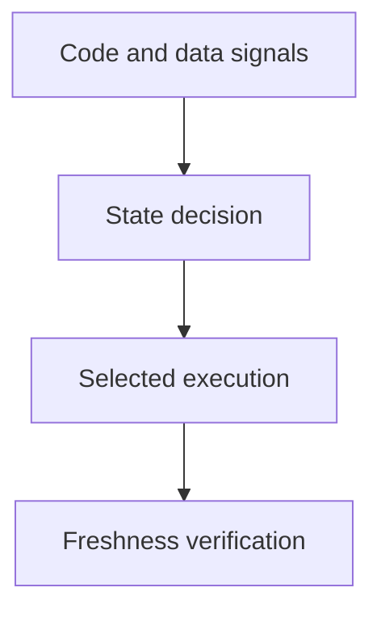

# dbt State and freshness-aware orchestration

Manifest-based state compares project code metadata. dbt State can use code and data signals where supported to determine what needs work. The platform also documents an older state-aware orchestration setting. Check the environment and job settings before enabling either, including their compatibility and how freshness expectations are defined.

Evaluate the effect on both cost and data readiness. Run baseline and pilot jobs, compare outcomes and missed updates, and define a recovery path when tracking information is incomplete.

## Practice

Use the orders pipeline to reason through unchanged code with newly arrived rows, changed code with unchanged data, and delayed ingestion. Predict how a scheduled build, a manifest selector, and a compatible dbt State setup should respond. Explain where you would measure downstream freshness.

## Recall

What should govern a skip decision when an upstream batch is late?

[dbt State in environments and jobs](https://docs.getdbt.com/docs/deploy/dbt-state-enable-env-jobs)

| Previous | Curriculum | Next |
| --- | --- | --- |
| [← Previous lesson](0036-dbt-copilot-wizard-and-reviewed-ai-changes.md) | [All lessons](index.md) | [Next lesson →](0038-platform-apis-integrations-and-dbt-mcp.md) |
