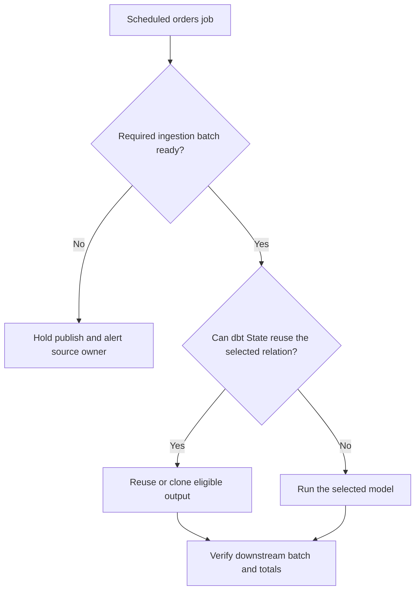

# dbt State and freshness-aware orchestration

Manifest comparison (`--state baseline --select state:modified+`) skips models when SQL code is unchanged, while naive hourly cron schedules rebuild every model even when upstream data did not arrive. **dbt State** bridges code state and data readiness by combining transformation changes, configs, target relation state, and upstream freshness signals to choose whether to **reuse**, **zero-copy clone** (where supported), or **rebuild** each selected model.

## Comparing selection and freshness mechanisms

| Mechanism | How it decides what to build |
| --- | --- |
| **Manifest comparison (`state:modified+`)** | Diffs project code and config against a saved `manifest.json`. Warehouse-only row updates go undetected. |
| **dbt State** | Evaluates code, config, relation existence, and upstream data freshness together; reuses or clones safe relations and rebuilds stale or modified ones. |
| **Source freshness (`dbt source freshness`)** | Compares source `loaded_at_field` against `warn_after` / `error_after` thresholds to alert or block stale ingestion. |



Tune dbt State policies on models with two configs:

- **`config.state.lag_tolerance`** sets how old an upstream change can be before forcing a rebuild (for example `2h` lets consumers tolerate two-hour freshness to save warehouse compute).
- **`config.state.require_fresh_data_from`** sets whether `any` or `all` direct parents must contain fresh data before rebuilding. Choose `all` when two feeds must align, and maintain a separate ingestion deadline alert so a silent missing feed does not stall publication unnoticed.

Note that older platform **State-aware orchestration** (`freshness.build_after`) and **dbt State** are mutually exclusive job toggles; migrate existing jobs explicitly after enabling dbt State on an environment. [About dbt State](https://docs.getdbt.com/docs/deploy/dbt-state-about) · [Migration guide](https://docs.getdbt.com/docs/deploy/dbt-state-migration) · [Enabling dbt State on environments and jobs](https://docs.getdbt.com/docs/deploy/dbt-state-enable-env-jobs)

!!! note "Runtime and adapter support"
    dbt State requires a dbt account (including for self-managed deployments). It is built into dbt v2 and v1.13, with a plugin for v1.7 through v1.12. Verify supported data platforms before rolling out; DuckDB supports this lesson's local manifest simulation below. [dbt State setup](https://docs.getdbt.com/docs/deploy/dbt-state-setup)

Walk through the local experiment one relation at a time. The staging view reads the changed raw row on its next query. The stored fact still contains the previous status until rebuilt. Selecting the seed again would reload the original CSV and erase your simulated warehouse update. This explains the narrower build in the exercise.

## Practice

### What you need

Use a disposable copy of [shop_lab](0004-adapters-profiles-and-the-local-shop-lab.md) with [`fct_orders`](0006-models-refs-and-project-configuration.md) and the original three rows.

### Steps

1. Build the baseline and save its manifest outside `target/`, then simulate an upstream warehouse load directly in DuckDB (leaving `seeds/raw_orders.csv` and model SQL untouched):

```bash
dbt build --profiles-dir . --select +fct_orders
mkdir -p baseline
cp target/manifest.json baseline/manifest.json

dbt run-operation run_query --profiles-dir . --args \
  "sql: update main.raw_orders set status = 'paid' where order_id = 2"
dbt ls --profiles-dir . --state baseline --select state:modified+
dbt build --profiles-dir . --select fct_orders
dbt show --profiles-dir . --inline "
select sum(case when status = 'paid' then total_cents else 0 end) as paid_revenue_cents
from {{ ref('fct_orders') }}"
```

**Expected result.** `state:modified+` returns an empty list (because code did not change), whereas the explicit `fct_orders` build picks up the updated row and raises `paid_revenue_cents` to **3,500**.

2. Temporarily change `status` to `upper(status) as status` in `models/fct_orders.sql` and rerun `dbt ls --profiles-dir . --state baseline --select state:modified+`. Confirm `fct_orders` now appears. Revert that edit, reseed, and rerun `dbt build --profiles-dir . --select +fct_orders` to return to **3,000** paid cents.
3. **Design scenarios (for a managed warehouse pilot).** Compare an ordinary job against dbt State on an isolated target and predict the outcome for three cases:
   - *New batch, unchanged SQL:* ordinary job always runs `fct_orders`; dbt State rebuilds only when it observes fresh upstream inputs and the model exceeds `lag_tolerance`.
   - *Changed SQL, no new batch:* both rebuild because compiled model logic changed.
   - *Late ingestion misses SLA:* hold downstream publication and alert the source owner.

Inspect the run's **Explain** tab (or `dbt state explain` on supported v2 runs), compare compute saved against SQL execution time, and keep a normal scoped build fallback when metadata signals are unreliable. Remember dbt State decides *whether* to build; model filters like incremental lookbacks still control *which rows* are read (see [lesson 0040](0040-capstone-incident-drill-and-portfolio-review.md)). [Node selection](https://docs.getdbt.com/reference/node-selection/methods) · [Source freshness](https://docs.getdbt.com/docs/build/sources)

## Recall

1. Why does an empty `state:modified+` listing after an ingestion load tell you nothing about whether data is ready to rebuild?
2. A downstream reporting model sets `require_fresh_data_from: all` across `orders` and `refunds`, and the `refunds` loader fails silently. What happens without an independent ingestion deadline?
3. How does `lag_tolerance: 2h` balance warehouse compute costs against dashboard freshness, and what are the three actions dbt State can take for a node?

??? note "Answer guidance"
    1. Manifest diffing inspects project files and configs, not warehouse table contents. Code stays identical when ingestion inserts new rows.
    2. The model keeps skipping rebuilds while waiting for `refunds`, leaving dashboards quietly stale unless an independent source freshness threshold or ingestion deadline raises an alert.
    3. `lag_tolerance` skips redundant rebuilds during frequent triggers until the tolerated staleness expires, trading slight latency for lower warehouse spend. For each node, dbt State chooses to reuse, zero-copy clone (where supported), or rebuild.

| Previous | Curriculum | Next |
| --- | --- | --- |
| [Previous lesson](0036-dbt-copilot-wizard-and-reviewed-ai-changes.md) | [All lessons](index.md) | [Next lesson](0038-platform-apis-integrations-and-dbt-mcp.md) |
