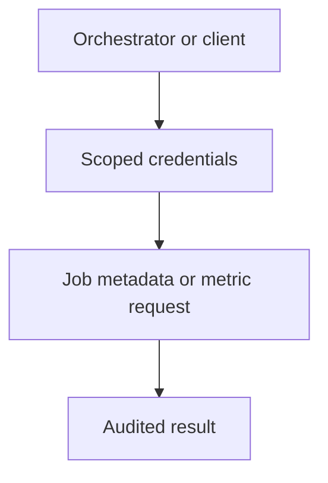

# Platform APIs, integrations and dbt MCP

The Administrative API can trigger job runs and retrieve operational information. The Discovery API exposes project and run metadata. The Semantic Layer APIs query defined business metrics. dbt MCP can expose selected metadata and tools to compatible AI clients. Give each integration only the capabilities and environments needed for its purpose.

If an external scheduler triggers a job, distinguish accepting a run request from completing the data build. Persist the run ID, check its terminal status, and handle retries in a way that avoids accidentally starting duplicate work.

## Practice

Design a service that triggers the daily deploy after ingestion and publishes the run outcome. Specify inputs, environment permissions, job identifier, run polling and deduplication. Give a separate analyst client only the access required to inspect a metric.

## Recall

Which API would you choose to trigger a run, inspect model lineage, or request revenue by month?

[dbt APIs](https://docs.getdbt.com/docs/dbt-apis/overview) · [dbt MCP server](https://docs.getdbt.com/docs/dbt-ai/about-mcp)

| Previous | Curriculum | Next |
| --- | --- | --- |
| [← Previous lesson](0037-dbt-state-and-freshness-aware-orchestration.md) | [All lessons](index.md) | [Next lesson →](0039-capstone-build-and-release-plan.md) |
