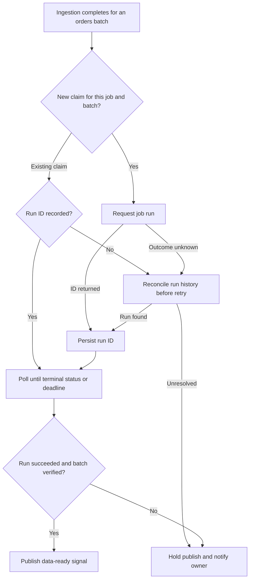

# Platform APIs, integrations and dbt MCP

When your ingestion pipeline, BI tool, metadata catalog, or AI assistant needs to interact with dbt programmatically, you move beyond manual UI clicks to **Platform APIs**, **webhooks**, and **dbt MCP**. Choose the interface by whether the caller triggers jobs, inspects lineage metadata, queries governed metrics, or invokes tools from an AI client.

## Platform APIs, webhooks, and dbt MCP

| Interface | Protocol and purpose |
| --- | --- |
| **Administrative API** | REST endpoints (v2 and v3 coexist with distinct paths) to trigger deploy jobs (`cause`, `git_sha`, `steps_override`), poll run status, and download artifacts. |
| **Outbound Webhooks** | Push HTTP callbacks (`job.run.started`, `job.run.completed`, `job.run.errored`) signed with an HMAC secret so downstream apps react immediately without polling loops. |
| **Discovery API** | GraphQL metadata API returning model lineage, test statuses, execution timings, and freshness across deployed environments. |
| **Semantic Layer APIs** | GraphQL, JDBC, Arrow Flight, and Python SDKs for querying governed metrics (`paid_revenue_cents`) with MetricFlow dimensions. |
| **dbt MCP server** | Model Context Protocol server exposing scoped dbt tools to AI agents. |

Match your account's regional API host, store service tokens in your orchestrator's secret manager (`Authorization: Token <service-token>`), verify plan support, and respect API rate limits with exponential backoff. [dbt APIs](https://docs.getdbt.com/docs/dbt-apis/overview) · [Administrative API](https://docs.getdbt.com/docs/dbt-apis/admin-api)

**Self-hosted vs remote dbt MCP.** A local self-hosted MCP server can run CLI commands directly against `shop_lab`. The dbt-hosted remote HTTP MCP server connects to platform services and never runs your local CLI. Enforce **least-privilege permissions** on the underlying service token and exposed tool list: grant a revenue analyst AI client `list_metrics` and `query_metrics`, while disabling write actions such as `trigger_job_run` and raw SQL execution. [dbt MCP server](https://docs.getdbt.com/docs/dbt-ai/about-mcp) · [Available tools](https://docs.getdbt.com/docs/dbt-ai/mcp-available-tools)

## Building an idempotent ingestion handoff



Never trigger a job blindly on network retries without tracking state. Claim a durable record keyed by `(environment, job, batch_id)` **before** sending `POST /run/`, persist the returned `data.id`, and reconcile run history by job, `cause`, and timestamp if a POST times out before returning an ID.

**Trace a lost response.** The platform accepts a start request, but the connection closes before the caller saves the run ID. A second POST could start the batch twice. Store the batch claim before sending the first request. On redelivery, use its correlation value to look up the original run and leave publication on hold while the outcome is unknown.

## Practice

### What you need

Trace these Administrative API v2 requests using sample IDs (or run against an authorized sandbox with a service token). The POST returns `data.id`; the GET polls `data.status` (`10` = Success; `20`, `30`, `40` = Error/Canceled/non-success requiring review). [Custom CI/CD pipelines](https://docs.getdbt.com/guides/custom-cicd-pipelines) · [Run status codes](https://docs.getdbt.com/reference/commands/run#status-codes)

```http
POST /api/v2/accounts/123/jobs/456/run/
Content-Type: application/json

{"cause":"shop orders sandbox batch orders-2026-01-04"}
```

```http
GET /api/v2/accounts/123/runs/789/
```

### Steps

1. Replay each scenario below and write a trace table listing the batch key, recorded `run_id`, next action, and publication decision:

| Input scenario | Expected handling |
| --- | --- |
| First delivery of batch, POST returns run `789`, GET statuses return `1`, `3`, `10` | Single POST, poll with backoff until `10`, publish only after verifying batch rows. |
| Duplicate webhook retries the same batch while `789` is still running | Claim exists: skip POST, keep polling run `789`. |
| POST times out with unknown outcome | Hold publish, list recent runs for job `456` matching `cause` and time, attach ID if found before ever re-triggering. |
| Run `789` finishes with status `20` (Error) | Hold publish and page owner with batch ID and run `789`. |
| Analyst agent requests `paid_revenue_cents`, then asks to trigger a job run | Allow `query_metrics` (**3,000** paid cents on original [shop_lab](0004-adapters-profiles-and-the-local-shop-lab.md) + [metrics](0027-metrics-time-spine-and-downstream-integrations.md)); deny `trigger_job_run` via scoped identity/tool allowlist. |

2. **With MCP access.** Inspect the actual tool list returned to your client against a sandbox loaded with `shop_lab` and confirm the ungrouped metric returns `3,000` while write actions stay denied.

## Recall

1. Which platform API answers a lineage question about `fct_orders`, and which returns `paid_revenue_cents` by day?
2. Why does receiving HTTP `200` and a `run_id` from `POST .../run/` still leave the dataset unready for dashboards?
3. How do outbound webhooks improve on polling `GET /api/v2/.../runs/{id}/`, and what must a receiver verify before trusting a webhook request?

??? note "Answer guidance"
    1. Use the Discovery API (GraphQL) for model lineage, test status, and metadata, and the Semantic Layer API for querying governed metrics (dbt MCP can expose both to authorized AI clients).
    2. The POST response confirms the run was enqueued or started, not completed. Consumers must wait for terminal status `10` (and verify the expected batch landed) before reading or refreshing dashboards.
    3. Webhooks push completion events immediately without polling loops or wasting API rate limits. Receivers must verify the webhook's HMAC signature header using the shared secret before acting on the payload.

| Previous | Curriculum | Next |
| --- | --- | --- |
| [Previous lesson](0037-dbt-state-and-freshness-aware-orchestration.md) | [All lessons](index.md) | [Next lesson](0039-capstone-build-and-release-plan.md) |
