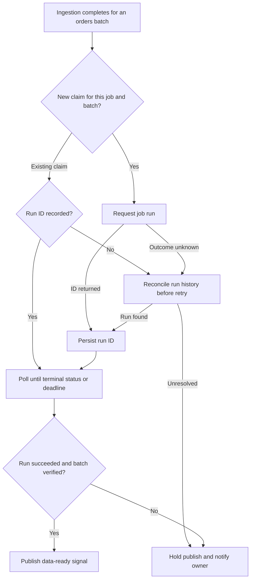

# Platform APIs, integrations and dbt MCP

| Task | Interface |
| --- | --- |
| Start the orders job, check its run status, or download an artifact | Administrative API |
| Find the upstream models, tests or freshness status for `fct_orders` | Discovery API (GraphQL metadata) |
| Query `paid_revenue_cents` with a governed time dimension | Semantic Layer APIs |
| Let an AI client discover and call selected dbt tools | dbt MCP server |

Use the account's regional API host and an identity scoped to the intended project and environment. Use a service account token for scheduled automation and store it in the scheduler's secret store. Check plan and endpoint support. Administrative API v2 and v3 coexist, and their routes differ. [dbt APIs](https://docs.getdbt.com/docs/dbt-apis/overview) · [Administrative API](https://docs.getdbt.com/docs/dbt-apis/admin-api)

dbt MCP (Model Context Protocol) gives assistants a tool interface over dbt capabilities. A self-hosted server can run local commands against `shop_lab`. The dbt-hosted remote server uses HTTP and does not run your local CLI. Its available tools depend on plan and permissions and can include write actions such as `trigger_job_run`. For a revenue analyst, allow `list_metrics` and `query_metrics` with scoped credentials. Disable or withhold job triggers, raw SQL and CLI writes. Verify the tool list exposed to the actual client and enforce permissions on the underlying identity. [dbt MCP server](https://docs.getdbt.com/docs/dbt-ai/about-mcp) · [Available tools](https://docs.getdbt.com/docs/dbt-ai/mcp-available-tools)



## Practice

Design the handoff from ingestion to a sandbox orders job. Walk through these Administrative API v2 requests using sample IDs, or use the official guide against a sandbox with authorized credentials. Both requests use the `Authorization: Token <service-token>` header. The POST sends JSON and returns the run ID as `data.id`. The GET returns the run status as `data.status`. [Custom CI/CD pipelines](https://docs.getdbt.com/guides/custom-cicd-pipelines) · [Run status codes](https://docs.getdbt.com/reference/commands/run#status-codes)

```http
POST /api/v2/accounts/123/jobs/456/run/
Content-Type: application/json

{"cause":"shop orders sandbox batch orders-2026-01-04"}
```

```http
GET /api/v2/accounts/123/runs/789/
```

Claim a durable record keyed by environment, job and ingestion batch **before** sending the POST. Save the run ID to that record. Poll with a deadline and backoff, honoring rate limits. Treat status 10 as success and statuses 20, 30 and 40 as non-success outcomes requiring review. On a timeout with no run ID, keep the claim pending and reconcile against run history using the job, batch label and request time. The `cause` label is for correlation. An ambiguous outcome requires resolution before another POST.

Replay these cases and write a trace with the batch key, run ID if known, next action and publication decision. Your design passes when each case produces the expected result.

| Input | Expected result |
| --- | --- |
| Batch first delivered, POST returns run 789, GET statuses are 1, 3, 10 | One POST, polling by run ID, publication only after the expected batch is verified. |
| The same batch event arrives again while 789 is running | Reuse 789, with zero additional POSTs. |
| POST times out after possible acceptance | Hold publication and look for the existing run. Attach its ID if found. |
| Run 789 ends with status 20 | Hold publication and alert with the batch and run ID. |
| Analyst asks for paid revenue and then requests a job run | Allow the governed metric query. Reject the job trigger with the analyst identity. |

For the analyst check, use the original [shop_lab data](0004-adapters-profiles-and-the-local-shop-lab.md) and [metric contract](0027-metrics-time-spine-and-downstream-integrations.md) as the expected response. The ungrouped result is **3,000 paid cents**. In a walkthrough, record the two requested capabilities and their allow or deny outcomes. With MCP access, capture the actual tool list and the result from a sandbox environment loaded with the same fixture.

## Recall

1. Which API answers a question about lineage? Which returns the paid revenue value?
2. Why does a successful trigger response leave the batch in a pending state?

??? note "Answer guidance"

    1. Use Discovery for lineage and the Semantic Layer for the metric value. MCP can expose both capabilities to an authorized client.
    2. The response identifies a queued or started run. Wait for a successful terminal status, then verify that the expected input batch reached the consumer-facing output.

| Previous | Curriculum | Next |
| --- | --- | --- |
| [Previous lesson](0037-dbt-state-and-freshness-aware-orchestration.md) | [All lessons](index.md) | [Next lesson](0039-capstone-build-and-release-plan.md) |
