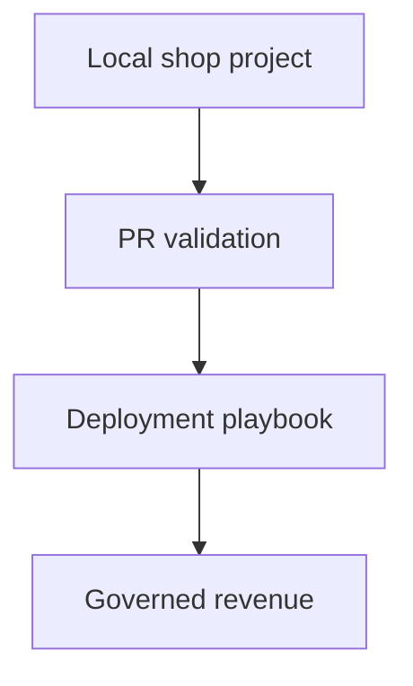

# Capstone build and release plan

Deliver a shop analytics project with a staging model, fact, lookup seed, snapshot, exposure, unit test, data tests, and a consistent paid revenue metric. Include a project graph, grain and owners, documented runtime and adapter choices, and selection commands that work from a fresh lab copy.

Design a deployment workflow with separate development, CI and production targets. Specify the difference between the PR check, merge deployment, and daily data refresh. Use the local sandbox for executable evidence and document platform setup as an exercise when credentials are unavailable.

## Practice

Restore the original three seed rows. Build the project, inspect the results and compare current metrics to the expected total and paid cents. Submit a sample PR plan showing what changes when the paid definition changes and which consumers must be told.

## Recall

What evidence would let a reviewer verify both the metric and the safety of the release?

[dbt deployments](https://docs.getdbt.com/docs/deploy/deployments) · [Review the support playbooks](../debugging/index.md)

| Previous | Curriculum | Next |
| --- | --- | --- |
| [← Previous lesson](0038-platform-apis-integrations-and-dbt-mcp.md) | [All lessons](index.md) | [Next lesson →](0040-capstone-incident-drill-and-portfolio-review.md) |
