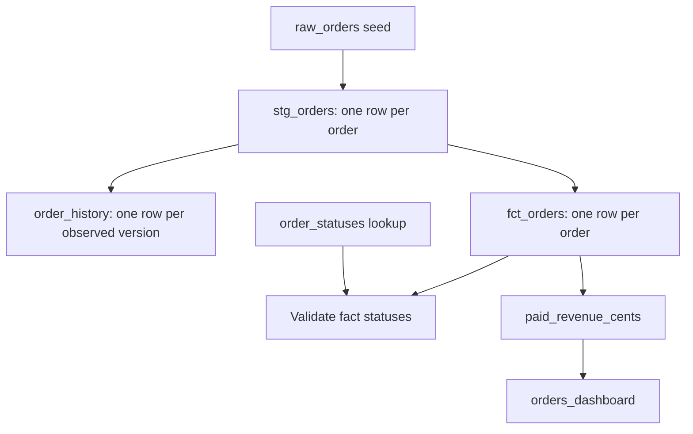

# Capstone build and release plan

In this capstone, you pull together every core resource from Modules 1 through 7 into one reproducible `shop_lab` project and write an operational release plan. Keep staging and `fct_orders` at one row per `order_id`, keep `order_history` SCD versions strictly separate from current fact aggregations, compute `order_total_cents` across all statuses, and compute `paid_revenue_cents` only where `status = 'paid'`.



## Build and verify the shop lab

Use a fresh or clean DuckDB copy of [shop_lab](0004-adapters-profiles-and-the-local-shop-lab.md) with the original three rows (`1,250`, `500`, `1,750` cents). Record `dbt --version`, adapter, and target. (Use SQL verification locally to confirm exact warehouse numbers, and query MetricFlow / Semantic Layer separately where configured.) [Semantic Layer YAML reference](https://docs.getdbt.com/reference/semantic-layer-reference) · [MetricFlow commands](https://docs.getdbt.com/docs/build/metricflow-commands)

1. Assemble [`fct_orders`](0006-models-refs-and-project-configuration.md), [`order_statuses`](0008-seeds-and-lookup-data.md), [`order_history`](0011-snapshots-and-slowly-changing-dimensions.md), [`paid_orders_have_positive_total`](0012-generic-and-singular-data-tests.md), and [`order_status_normalizes_case`](0013-unit-tests-and-edge-cases.md).
2. In `models/fct_orders.yml`, ensure `fct_orders` documents its grain and transformation owner, keeps `unique` + `not_null` on `order_id` and `accepted_values` on `status`, and adds a `relationships` check against `order_statuses` (which tests `status` as `unique` and `not_null`):

```yaml
      - name: status
        data_tests:
          - not_null
          - accepted_values:
              arguments:
                values: [paid, pending]
          - relationships:
              arguments:
                to: ref('order_statuses')
                field: status
```

3. Merge the [semantic model](0026-metricflow-semantic-models-and-entities.md) and [revenue metrics](0027-metrics-time-spine-and-downstream-integrations.md) onto `fct_orders`, and add `metric('paid_revenue_cents')` alongside `ref('fct_orders')` in the [exposure definition](0019-model-documentation-exposures-and-ownership.md) for `orders_dashboard` with an explicit consumer owner (remember real production period metrics need an immutable payment timestamp rather than `updated_at`).
4. Build the full capstone slice, archive evidence immediately, trace exposure lineage, and reconcile totals:

```bash
dbt --version
dbt build --profiles-dir . --select +fct_orders order_statuses +order_history time_spine_daily
mkdir -p evidence/release
cp target/manifest.json target/run_results.json evidence/release/
dbt ls --profiles-dir . --select +exposure:orders_dashboard
jq '.metrics["metric.shop_lab.paid_revenue_cents"].depends_on.nodes' evidence/release/manifest.json
dbt show --profiles-dir . --inline "select count(*) as open_versions from {{ ref('order_history') }} where dbt_valid_to is null"
dbt show --profiles-dir . --inline "
select
    count(*) as orders,
    count(distinct order_id) as distinct_orders,
    sum(total_cents) as order_total_cents,
    sum(case when status = 'paid' then total_cents else 0 end) as paid_revenue_cents
from {{ ref('fct_orders') }}"
```

**Acceptance.** Unit tests and data tests pass, `order_history` holds 3 open versions (`dbt_valid_to is null`), the exposure selector includes `raw_orders`, `stg_orders`, and `fct_orders`, and `fct_orders` returns **3 orders**, **3 distinct IDs**, **3,500 total cents**, and **3,000 paid cents**. On local dbt 2.0.12 the selector omits the metric from this listing. The separate manifest query should return `semantic_model.shop_lab.fct_orders` as the metric's parent. Match `unique_id` values across `evidence/release/` and record the commit SHA, `invocation_id`, and numbers. [dbt artifacts reference](https://docs.getdbt.com/reference/artifacts/dbt-artifacts) · [Exposures](https://docs.getdbt.com/docs/build/exposures)

## Review the release and rollback plan

Write a release plan around a sample PR that alters which statuses qualify as `paid`. Include the metric diff, a regression unit/data test for the new status, before/after expected totals, and explicit sign-off from the `orders_dashboard` owner.

| Stage | Target, tooling, and gate |
| --- | --- |
| **Developer build** | Personal schema or DuckDB copy. Run `sqlfmt`, `dbt-checkpoint`, unit/data tests, and inspect compiled SQL + metric diff. |
| **PR check (CI)** | Temporary PR schema. Run `sqlfmt --check`, `dbt check` (`dbt-project-evaluator`), `dbt parse` + `dbt-checkpoint`, and Slim CI (`dbt build --select state:modified+ --state baseline --defer --favor-state`, with the deployed manifest in `baseline/`), bootstrapping with a full build if no baseline exists. |
| **Merge deployment (CD)** | Production service identity on `main`. Build modified nodes and tests, verify row counts and metric totals at the merged SHA, update baseline artifacts, and notify the dashboard owner. |
| **Daily refresh** | Trigger after ingestion via API or schedule with a hard `dbt source freshness` gate. Run `dbt build --select +fct_orders` (serialized against merge writes), collect observability telemetry, and verify served batch totals before clearing alerts. |

Name the source owner, transformation on-call, and dashboard owner, plus criteria to halt publication, which commit SHA to redeploy on rollback, and which tables require rebuilding after a bad release. [dbt deployments](https://docs.getdbt.com/docs/deploy/deployments) · [dbt scheduler](https://docs.getdbt.com/docs/deploy/job-scheduler) · [Support playbooks](../debugging/index.md)

**Release decision.** The fixture has three distinct orders and the paid total is 3,000 cents. Would you approve a change that preserves both numbers but drops the pending order and adds a new zero-cent order? Compare the set of order IDs and each order's status and amount against staging. Record any intended differences alongside the dashboard owner's decision.

To finish the release plan, choose one package from lessons 0031–0035. Name the defect it should catch, the version you would pin, and whether a failure should block the PR or alert the owner. Explain that decision for the orders dashboard.

## Recall

1. What concrete evidence proves to a PR reviewer that both the fact's grain and `paid_revenue_cents` are intact?
2. After reverting a bad model commit in Git, what operational steps remain before dashboards are healthy again?
3. Why must `order_history` remain separate from `fct_orders` when computing `paid_revenue_cents`?

??? note "Answer guidance"
    1. `unique` + `not_null` key test results, matching `orders` and `distinct_orders` counts, a pending-order regression test case, reconciled `order_total_cents` (3,500) and `paid_revenue_cents` (3,000), plus the commit SHA, `invocation_id`, and affected exposure owner sign-off.
    2. Redeploy the known-good commit in production, rebuild/backfill any affected tables and downstream marts, reconcile totals against source, and trigger downstream dashboard/BI refreshes.
    3. `order_history` stores multiple SCD Type 2 version rows per `order_id`; summing `total_cents` across snapshot history would multiply historical versions of the same order.

| Previous | Curriculum | Next |
| --- | --- | --- |
| [Previous lesson](0038-platform-apis-integrations-and-dbt-mcp.md) | [All lessons](index.md) | [Next lesson](0040-capstone-incident-drill-and-portfolio-review.md) |
