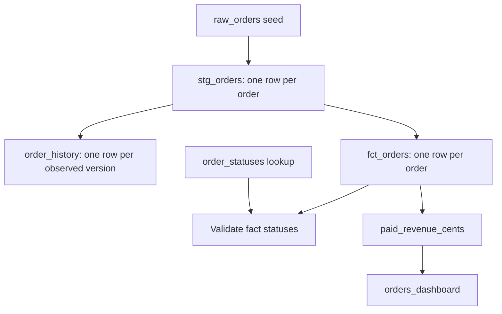

# Capstone build and release plan

Ship a paid revenue definition that another engineer can reproduce and a deployment plan that names who owns each handoff. Keep one row per `order_id` in staging and the fact. `order_total_cents` sums all orders. `paid_revenue_cents` sums cents only for `status = 'paid'`. The snapshot records observed history at one row per order version. Keep that history out of the current fact's aggregation.



## Build and verify the lab

Use a fresh or disposable DuckDB copy of [shop_lab](0004-adapters-profiles-and-the-local-shop-lab.md) with the original three rows. Record `dbt --version`, the adapter and the target. These commands use the dbt v2 lab and its local profile. Use the semantic YAML and MetricFlow commands supported by your release. The local SQL check verifies the warehouse values behind the metrics. Query the actual Semantic Layer as a separate check when a compatible setup is available. [Semantic Layer YAML reference](https://docs.getdbt.com/reference/semantic-layer-reference) · [MetricFlow commands](https://docs.getdbt.com/docs/build/metricflow-commands)

1. Assemble [`fct_orders`](0006-models-refs-and-project-configuration.md), [`order_statuses`](0008-seeds-and-lookup-data.md) and [`order_history`](0011-snapshots-and-slowly-changing-dimensions.md). Keep the [fact data tests](0012-generic-and-singular-data-tests.md) and [status normalization unit test](0013-unit-tests-and-edge-cases.md).
2. Test `order_statuses.status` for uniqueness and nulls. Add a relationship test on the existing `fct_orders.status` column with `to: ref('order_statuses')` and `field: status` under `arguments`. Keep the accepted-values test. Add model descriptions with grains and name the transformation owner.
3. Define the [order semantic model](0026-metricflow-semantic-models-and-entities.md) and [both revenue metrics](0027-metrics-time-spine-and-downstream-integrations.md) on `fct_orders`. Add `metric('paid_revenue_cents')` to the existing `orders_dashboard` [exposure dependencies](0019-model-documentation-exposures-and-ownership.md), which also include `ref('fct_orders')`. Assign a dashboard owner responsible for consumer validation. Use an immutable order or payment date for production period reporting.

```bash
dbt --version
dbt build --profiles-dir . --select +fct_orders order_statuses +order_history
mkdir -p evidence/release
cp target/manifest.json target/run_results.json evidence/release/
dbt ls --profiles-dir . --select +exposure:orders_dashboard
dbt show --profiles-dir . --inline "
select
    count(*) as orders,
    count(distinct order_id) as distinct_orders,
    sum(total_cents) as order_total_cents,
    sum(case when status = 'paid' then total_cents else 0 end) as paid_revenue_cents
from {{ ref('fct_orders') }}"
```

**Acceptance.** The build passes the unit and data tests, the first snapshot has three current versions (`dbt_valid_to is null`), and the lineage reaches the dashboard. The fact has three rows and three distinct order IDs. Expect **3,500 total cents** and **3,000 paid cents**. Retain the build artifacts before later commands can replace them. Match results to manifest nodes by `unique_id` and record the commit, invocation ID and metric output. [dbt artifacts reference](https://docs.getdbt.com/reference/artifacts/dbt-artifacts) · [Exposures](https://docs.getdbt.com/docs/build/exposures)

## Review the release

Write a release plan with a sample PR that changes which orders qualify as paid. Include the metric diff, a test for a newly included or excluded status, expected totals, and who signs off on the dashboard change.

| Step | Target and gate |
| --- | --- |
| Developer build | Personal schema or DuckDB file. Run the lab checks and review the compiled SQL and metric diff. |
| PR check | Temporary schema per PR. Require a successful build and tests before merge. If using slim CI, compare against the last successful production manifest, review `state:modified+`, and verify any deferred reads. Bootstrap with a full CI build when no baseline exists. |
| Merge deployment | Deploy the approved commit with a production service identity and build the affected models. Verify model results and the metric before advancing the baseline and notifying the dashboard owner. |
| Daily refresh | Run after ingestion and check the required batch or source freshness before the build. Use a data refresh selection such as `dbt build --select +fct_orders` for the lab graph. Serialize writes to the same production relations across the merge and refresh jobs. Check the served batch and revenue before clearing the alert. |

Name the source owner, transformation on-call and dashboard owner. Include when to pause publication, which prior commit to redeploy, and which relations must be rebuilt or reconciled after rollback. For a local submission, provide the executed lab evidence and show which job targets run each platform check. [dbt deployments](https://docs.getdbt.com/docs/deploy/deployments) · [dbt scheduler](https://docs.getdbt.com/docs/deploy/job-scheduler) · [Support playbooks](../debugging/index.md)

## Recall

1. What evidence lets a reviewer verify the grain and the paid revenue definition?
2. What does the production owner still need to do after reverting a change that wrote bad rows?

??? note "Answer guidance"

    1. Provide a key test and row counts, a pending-order regression case, both revenue totals, and the run and commit identifiers. The exposure identifies the consumer that needs to verify the result.
    2. Redeploy the known-good commit, rebuild or correct affected data, reconcile the totals and refresh affected consumers. Git history alone does not repair warehouse state.

| Previous | Curriculum | Next |
| --- | --- | --- |
| [Previous lesson](0038-platform-apis-integrations-and-dbt-mcp.md) | [All lessons](index.md) | [Next lesson](0040-capstone-incident-drill-and-portfolio-review.md) |
