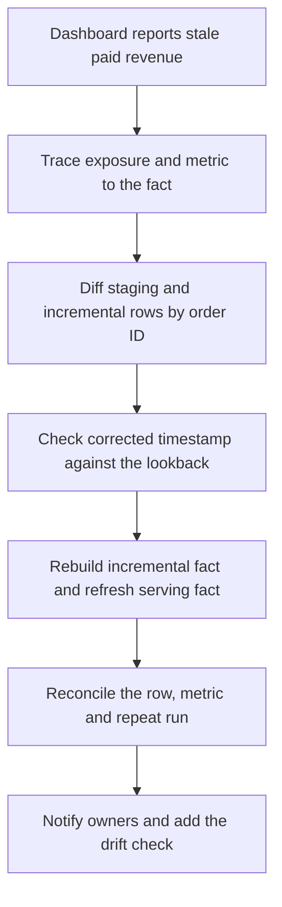

# Capstone incident drill and portfolio review

An executive opens `orders_dashboard` and sees **3,000 paid cents**, even though Finance corrected order 1 from 1,250 to 1,500 cents yesterday. Every job in the scheduler looks green. Your job is to trace `orders_dashboard` through `paid_revenue_cents`, `fct_orders`, and `fct_orders_incremental` down to `stg_orders`, pinpoint where reality diverged, recover safely, add an automated regression check, and deliver a postmortem. Use the [release plan](0039-capstone-build-and-release-plan.md) for owners and escalation contacts.



## Reproduce the missed backdated correction

Use a disposable copy of [shop_lab](0004-adapters-profiles-and-the-local-shop-lab.md) containing the original 3 rows, [`fct_orders_incremental`](0010-incremental-models-late-data-and-backfills.md) (2-day lookback), and [`fct_orders`](0006-models-refs-and-project-configuration.md). Point `models/fct_orders.sql` at `{{ ref('fct_orders_incremental') }}` so the serving fact consumes the incremental table.

1. Build the baseline cleanly:

```bash
dbt build --profiles-dir . --full-refresh --select +fct_orders
```

2. Simulate a backdated source correction by replacing order 1's row in `seeds/raw_orders.csv` with a `2025-12-31` timestamp:

```csv
1,101,paid,1500,2025-12-31 10:00:00
```

3. Run a normal incremental build, save its artifacts as incident evidence, and compare `stg_orders` against `fct_orders`:

```bash
dbt build --profiles-dir . --select +fct_orders
mkdir -p evidence/incident
cp target/manifest.json target/run_results.json evidence/incident/
dbt show --profiles-dir . --inline "
select 'staging' as relation_name, count(*) as orders,
    sum(total_cents) as total_cents,
    sum(case when status = 'paid' then total_cents else 0 end) as paid_cents
from {{ ref('stg_orders') }}
union all
select 'serving fact', count(*), sum(total_cents),
    sum(case when status = 'paid' then total_cents else 0 end)
from {{ ref('fct_orders') }}"
```

**Expected result.** Both relations have 3 rows, yet `stg_orders` reports **3,750 total / 3,250 paid cents** while `fct_orders` remains stuck at **3,500 total / 3,000 paid cents**! Because `fct_orders_incremental` holds `max(updated_at) = 2026-01-03 10:00:00`, its 2-day lookback (`2026-01-01 10:00:00`) skips order 1's backdated `2025-12-31` correction. Note also that backdated edits violate the monotonically increasing `updated_at` assumption of a `timestamp`-strategy snapshot (switch to `strategy: check` or CDC if mutable historical timestamps occur). [Snapshots](https://docs.getdbt.com/docs/build/snapshots)

## Recover and prevent recurrence

1. Add a singular reconciliation check in `tests/incremental_orders_match_staging.sql` (assumes `order_id` uniqueness and `not_null` are tested separately on both relations):

```sql
select coalesce(s.order_id, i.order_id) as order_id
from {{ ref('stg_orders') }} as s
full outer join {{ ref('fct_orders_incremental') }} as i using (order_id)
where s.order_id is null
   or i.order_id is null
   or s.total_cents is distinct from i.total_cents
   or s.customer_id is distinct from i.customer_id
   or s.status is distinct from i.status
   or s.updated_at is distinct from i.updated_at
```

2. Run `dbt test --profiles-dir . --select incremental_orders_match_staging` and confirm it catches order 1.
3. Execute a scoped full refresh on the incremental model, rebuild the serving fact, verify the reconciliation passes, and test idempotency by replaying a normal `+fct_orders` build:

```bash
dbt run --profiles-dir . --full-refresh --select fct_orders_incremental
dbt build --profiles-dir . --select fct_orders
dbt test --profiles-dir . --select incremental_orders_match_staging
dbt build --profiles-dir . --select +fct_orders
dbt test --profiles-dir . --select incremental_orders_match_staging
```

**Acceptance.** Order 1 shows **1,500 cents** in both facts, counts remain 3 rows / 3 unique IDs, both totals stabilize at **3,750 total / 3,250 paid cents**, and the reconciliation test returns 0 rows after both recovery and replay. Refresh connected dashboards to confirm consumer recovery.

In production, pause colliding writes before running a key- or partition-scoped backfill (or controlled full rebuild after checking adapter costs and grants). Trigger incremental backfills from an immutable ingestion timestamp (`_loaded_at`) or change log rather than mutable `updated_at`, because `max(updated_at)` freshness checks also miss backdated edits! [Incremental models](https://docs.getdbt.com/docs/build/incremental-models) · [Debugging playbook](../debugging/incremental-recovery.md)

A matching grand total can still hide a customer attribution error. If order 1 moves from customer 101 to 102, both revenue totals and the order count stay the same. The per-order comparison checks `customer_id` as well as amount, status and timestamp. A successful repair leaves no changed, missing or extra orders.

## Portfolio postmortem review

Compile your capstone portfolio package with the [release plan](0039-capstone-build-and-release-plan.md), incident `manifest.json` and `run_results.json`, Git SHA, recovery commands, and a concise postmortem covering:

1. **Timeline.** When the correction landed, when the silent run succeeded, and when recovery completed.
2. **Root cause.** Lookback cutoff on mutable `updated_at` excluded `2025-12-31`.
3. **Blast radius.** `orders_dashboard` understated paid revenue by 250 cents (`3,000` vs `3,250`) during the incident window.
4. **Detection gap.** Scheduler green status and `max(updated_at)` freshness missed backdated edits.
5. **Mitigation and verification.** Scoped `--full-refresh`, serving rebuild, zero-difference replay proof, and `orders_dashboard` sign-off.
6. **Prevention and owner.** `incremental_orders_match_staging` test and switching incremental watermarks to `_loaded_at` or CDC, assigned to the transformation owner.

Restore the original 3-row CSV and baseline build if reusing `shop_lab`.

## Recall

1. Why could both the scheduled `dbt build` and a `max(updated_at)` freshness check stay green while `orders_dashboard` showed revenue 250 cents low?
2. What evidence proves a bounded backfill repaired the target safely without introducing duplicate keys?
3. Why does a backdated `updated_at` edit (`2025-12-31`) also pose a problem for `order_history` if that snapshot uses `strategy: timestamp`?

??? note "Answer guidance"
    1. The incremental query filtered only the latest 2 days around `2026-01-03`, skipping order 1 cleanly without error, and the maximum timestamp stayed at `2026-01-03`. A freshness check at the same observation time would give the same result before and after the edit. Its pass or fail status depends on the threshold and check time.
    2. Key-level diffing against staging returns 0 mismatched rows, `unique` + `not_null` tests pass, revenue totals reconcile, and running the ordinary build a second time produces identical counts and sums.
    3. The `timestamp` strategy only captures versions when `updated_at` is strictly newer than the snapshot's stored `dbt_updated_at`. A backdated timestamp looks older than the existing open version and is ignored unless you use `strategy: check` or CDC.

| Previous | Curriculum | Next |
| --- | --- | --- |
| [Previous lesson](0039-capstone-build-and-release-plan.md) | [All lessons](index.md) | [Next lesson](0041-cloud-run-jobs-and-bigquery.md) |
