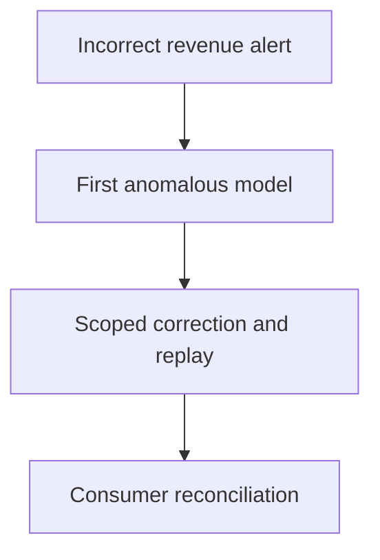

# Capstone incident drill and portfolio review

Run an incident drill where an order is corrected outside the incremental lookback and a dashboard shows the earlier revenue. Compare raw, incremental and full-table results. Trace the dashboard through the metric and exposure, locate the affected records, and choose a bounded correction or full rebuild based on the warehouse and blast radius.

Close the incident with a reconciliation query, repeatability evidence, an updated check, and communication to the model and dashboard owners. Capture why the original policy missed the correction.

## Practice

Restore the original fixture. Reset the lab fact with `dbt build --full-refresh --select +fct_orders_incremental`. Change order 1 to 1,500 cents and set its timestamp to `2025-12-31 10:00:00` to simulate a historical correction. Reseed and run the ordinary incremental build. Compare its paid total of 3,000 cents to the 3,250 cents from a full query on staging. Then apply and verify a scoped recovery in the lab. Record the run and commit identifiers, warehouse checks, and the owner responsible for the decision.

## Recall

Which prevention would have detected the missed correction earliest without rebuilding every model on every run?

[Debugging playbooks](../debugging/index.md) · [Interview question bank](../interview/index.md)

| Previous | Curriculum | Next |
| --- | --- | --- |
| [← Previous lesson](0039-capstone-build-and-release-plan.md) | [All lessons](index.md) | — |
