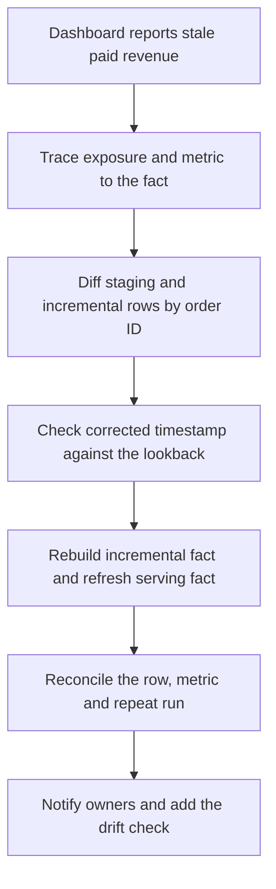

# Capstone incident drill and portfolio review

The orders dashboard still shows **3,000 paid cents** after a historical correction. Trace `orders_dashboard` through `paid_revenue_cents` to its serving fact, then find the first relation that disagrees with the input. Record the last known-good run and the first stale result. Use the [release plan](0039-capstone-build-and-release-plan.md) for the dashboard owner, escalation path and baseline checks.



## Reproduce the missed correction

Use a disposable [shop_lab](0004-adapters-profiles-and-the-local-shop-lab.md) copy with the original fixture, the [two-day incremental model](0010-incremental-models-late-data-and-backfills.md) and [`fct_orders`](0006-models-refs-and-project-configuration.md). In this drill, change the input ref in `models/fct_orders.sql` from `stg_orders` to `fct_orders_incremental`. The dashboard's existing metric can now read stale rows through the fact. Run the baseline build from the lab directory.

```bash
dbt build --profiles-dir . --full-refresh --select +fct_orders
```

Replace only order 1's row in `seeds/raw_orders.csv` with the following. Keep its paid status and customer ID.

```csv
1,101,paid,1500,2025-12-31 10:00:00
```

Run an ordinary build to reseed and execute the incremental filter. Save its successful run results as incident evidence.

```bash
dbt build --profiles-dir . --select +fct_orders
mkdir -p evidence/incident
cp target/manifest.json target/run_results.json evidence/incident/
dbt show --profiles-dir . --inline "
select 'staging' as relation_name, count(*) as orders,
    sum(total_cents) as total_cents,
    sum(case when status = 'paid' then total_cents else 0 end) as paid_cents
from {{ ref('stg_orders') }}
union all
select 'serving fact', count(*), sum(total_cents),
    sum(case when status = 'paid' then total_cents else 0 end)
from {{ ref('fct_orders') }}"
```

Expect three rows in each relation. Staging shows **3,750 total / 3,250 paid cents**, while the serving fact shows **3,500 total / 3,000 paid cents**. Check order 1 in `raw_orders`, `stg_orders` and `fct_orders_incremental` to locate the first stale value. The incremental target's maximum timestamp is `2026-01-03 10:00:00`, so its two-day lookback starts at `2026-01-01 10:00:00`. The corrected row falls outside that range. The backdated update also breaks the assumption of a monotonically advancing `updated_at` used by the timestamp snapshot strategy, so inspect raw and staging during diagnosis. [Snapshots](https://docs.getdbt.com/docs/build/snapshots)

## Recover and prevent a repeat

Save this singular test as `tests/incremental_orders_match_staging.sql`. It checks for missing or extra keys and changed revenue inputs. It assumes keys are non-null and unique, which should be tested independently on each side.

```sql
select coalesce(s.order_id, i.order_id) as order_id
from {{ ref('stg_orders') }} as s
full outer join {{ ref('fct_orders_incremental') }} as i using (order_id)
where s.order_id is null
   or i.order_id is null
   or s.total_cents is distinct from i.total_cents
   or s.status is distinct from i.status
   or s.updated_at is distinct from i.updated_at
```

Run `dbt test --profiles-dir . --select incremental_orders_match_staging` and confirm one failing row for order 1 using the test query. For the tiny DuckDB lab, scope the full refresh to the incremental relation. Then rebuild the serving fact and rerun the reconciliation.

```bash
dbt run --profiles-dir . --full-refresh --select fct_orders_incremental
dbt build --profiles-dir . --select fct_orders
dbt test --profiles-dir . --select incremental_orders_match_staging
dbt build --profiles-dir . --select +fct_orders
dbt test --profiles-dir . --select incremental_orders_match_staging
```

**Acceptance.** Verify order 1 reads **1,500 cents** in both facts, with three rows and three distinct order IDs each. Repeat the aggregate query after recovery and after the ordinary replay. Both fact totals should remain **3,750 total / 3,250 paid cents**, and the reconciliation should return zero rows both times. With a connected dashboard, refresh it and confirm the served value. In the lab, use the serving-fact query as the consumer check.

In production, pause conflicting writes and choose between a key- or partition-scoped backfill and a full rebuild after checking adapter behavior, affected keys, runtime and downstream dependencies. Use a trusted ingestion timestamp or change feed to identify corrections. For a large fact, run the reconciliation on the affected keys or partitions using that signal. A freshness alert based on the latest timestamp can miss this historical change. [Incremental models](https://docs.getdbt.com/docs/build/incremental-models) · [Debugging playbook](../debugging/incremental-recovery.md)

## Portfolio review

Attach the release plan, incident run and commit IDs, selected commands, and before/after totals. Write a brief incident update naming the dashboard, time window during which it served a value 250 cents low, recovery action, replay evidence and prevention owner. Ask the dashboard owner to confirm the restored result. Restore the original fixture and serving fact from your release baseline when reusing the lab.

## Recall

1. Why were the build and the latest-timestamp check able to look healthy while revenue was wrong?
2. What evidence makes a bounded backfill safe to replay?

??? note "Answer guidance"

    1. The build processed rows inside the lookback. Order 1 fell outside it and the maximum timestamp stayed on order 3. A comparison by key exposed the mismatch.
    2. Identify the exact keys or partitions and use a reviewed key-based or partition replacement. Reconcile keys and totals, then rerun on the same input and confirm the same results without duplicates.

| Previous | Curriculum | Next |
| --- | --- | --- |
| [Previous lesson](0039-capstone-build-and-release-plan.md) | [All lessons](index.md) | [Next lesson](0041-cloud-run-jobs-and-bigquery.md) |
