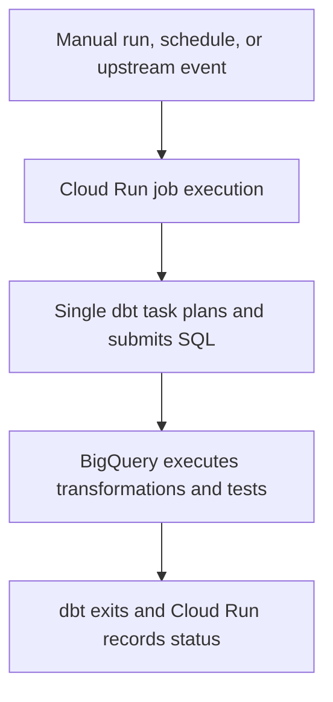

# Choose a GCP runtime for dbt

dbt Core submits SQL to BigQuery and waits for results. BigQuery runs the transformations and stores the tables. The Cloud Run container handles parsing, compilation, dependency ordering, and result collection. A Cloud Run job starts a container task, waits for it to exit, and records whether it succeeded. It needs no HTTP server.

Use one Cloud Run task for a single dbt graph. The dbt profile controls SQL concurrency through `threads`. Increasing the Cloud Run task count launches more copies of the command. Multiple tasks make sense only when each one gets a disjoint unit of work and the writes are safe to parallelize.

| GCP component | Use in a dbt pipeline |
| --- | --- |
| Cloud Run Jobs | Execute a packaged dbt project to completion. |
| Cloud Run services or functions | Receive a webhook or event and start a job asynchronously. Use job execution status to track the outcome. |
| Cloud Scheduler | Start work on a cron schedule. |
| Workflows and Eventarc | Wait for job completion, branch on results, or start a workflow after an upstream event. |
| Google Cloud Batch | Consider when a workload needs VM-specific resources or more control over task placement. |
| Cloud Composer | Consider when an existing Airflow DAG already owns ingestion dependencies, backfills, and monitoring. |
| BigQuery scheduled queries | Useful for standalone SQL on a timer. dbt project selection, macros, and tests require a dbt runner. |

## Practice

Map the [shop release plan](0039-capstone-build-and-release-plan.md) onto GCP. Choose where the image, raw data, and modeled data live. Draw the boundaries between orchestration, dbt execution, and warehouse compute. If ingestion arrives late, decide whether you want to wait for an event or alert on freshness during a scheduled run.

## Recall

What happens if you set the task count to three with the same dbt command and target dataset?

??? note "Answer guidance"

    Each task can run the same graph and compete to write the same relations. Start with a single task. Tune dbt threads against BigQuery capacity and use separately scoped datasets or selectors for deliberate parallelism.

[Cloud Run resource model](https://docs.cloud.google.com/run/docs/resource-model) · [Workflows overview](https://docs.cloud.google.com/workflows/docs/overview) · [Batch overview](https://docs.cloud.google.com/batch/docs/get-started) · [BigQuery scheduled queries](https://docs.cloud.google.com/bigquery/docs/scheduling-queries)

| Previous | Curriculum | Next |
| --- | --- | --- |
| [← Previous lesson](0040-capstone-incident-drill-and-portfolio-review.md) | [All lessons](index.md) | [Next lesson →](0042-build-and-deploy-dbt-to-cloud-run.md) |
