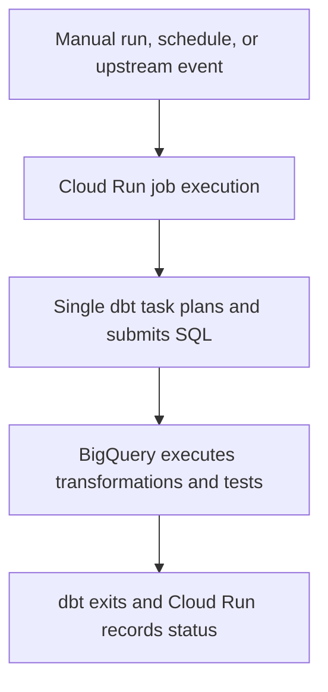

# Choose a GCP runtime for dbt

Teams running self-hosted dbt Core without a dedicated Kubernetes cluster or Airflow server can execute dbt serverlessly on Google Cloud. In this architecture, **Cloud Run Jobs** runs a packaged dbt container to completion and **BigQuery** stores tables and performs all SQL compute. Because Cloud Run Jobs scales to zero between runs and needs no HTTP listener, you pay only while dbt parses, dispatches queries, and collects results.

## Separating dbt runner responsibilities from BigQuery

- **Where work happens.** BigQuery executes every `SELECT`, `MERGE`, and test query, while the Cloud Run container parses project files, resolves Jinja, orchestrates `threads` concurrent BigQuery API calls, and writes `target/` artifacts. Size container memory around project parse footprint (1 to 4 GiB for medium to large DAGs) rather than warehouse table size.
- **Task count vs `threads`.** Run **1 Cloud Run task** (`--tasks=1`) for a dbt DAG and tune parallelism through `threads` in `profiles.yml`. Increasing `--tasks` launches multiple identical containers that fight over the same target tables unless each task reads `CLOUD_RUN_TASK_INDEX` and selects disjoint slices.
- **Stateless containers and timeouts.** The container filesystem disappears when the task exits, so stream logs to Cloud Logging and upload `target/` artifacts to Cloud Storage before exit. Cloud Run gives each CPU task attempt 10 minutes by default. Set `--task-timeout` above the expected build duration, up to 168 hours for CPU tasks. A retry starts a new attempt with its own time allowance. [Cloud Run task timeouts](https://docs.cloud.google.com/run/docs/configuring/task-timeout)

## Comparing GCP orchestration and compute options

| GCP component | Role in a dbt pipeline |
| --- | --- |
| **Cloud Run Jobs** | Executes a packaged dbt Core CLI container to completion with zero idle server cost. |
| **Cloud Run services / Cloud Functions** | Receives an HTTP webhook or ingestion event and triggers a Cloud Run job asynchronously. |
| **Cloud Scheduler** | Starts a Cloud Run job or Workflow on a cron timer. |
| **Workflows and Eventarc** | Reacts to Cloud Storage or Pub/Sub ingestion events, waits for Cloud Run job completion, branches on success/failure, and triggers downstream consumers. |
| **Google Cloud Batch** | Fits workloads requiring custom VM machine types, GPUs, or specialized placement beyond Cloud Run container limits. |
| **Cloud Composer** | Managed Apache Airflow; use when existing Airflow DAGs already coordinate multi-system ingestion, backfills, and SLAs. |
| **BigQuery scheduled queries** | Runs standalone SQL on a timer without dbt `ref()`, macros, `tests/`, or artifact state. |

## Practice

### Scenario

Map the [shop release plan](0039-capstone-build-and-release-plan.md) onto Google Cloud components:

1. Identify where the **Docker image** (Artifact Registry), **raw tables** (ingestion BigQuery dataset), **modeled tables** (`dbt_lab` dataset), and **run artifacts** (`manifest.json`, `run_results.json` in a GCS bucket) live.
2. Draw the identity and execution boundaries separating the trigger principal (Scheduler/Workflows), the Cloud Run Jobs dbt runner (Runtime Service Account), and BigQuery compute/storage.
3. Choose between a cron trigger gated by `dbt source freshness` and an Eventarc + Workflows trigger emitted after ingestion commits, and set a concrete `--task-timeout` and memory size for `shop_lab`.

**Check your drawing.** Follow one execution from the trigger to the dashboard. The trigger can start the job, the runtime identity can submit BigQuery queries, and the dashboard reads the modeled dataset. Label which identity would receive a permission error if BigQuery denied the write. It should be the runtime identity.

## Recall

1. What happens if you deploy a Cloud Run job with `--tasks=3` running `dbt build --select +fct_orders` against the same `dbt_lab` dataset?
2. Why does a Cloud Run container running `dbt-bigquery` over a 10 TB table not need 10 TB of container memory, and what *does* dictate its RAM sizing?
3. When should a team pick Cloud Composer or BigQuery scheduled queries instead of Cloud Run Jobs?

??? note "Answer guidance"
    1. All three container tasks execute the exact same dbt DAG simultaneously and collide writing to the same BigQuery tables. Start with `--tasks=1` and adjust `threads` in `profiles.yml`; only use `--tasks > 1` with disjoint per-task selectors keyed by `CLOUD_RUN_TASK_INDEX`.
    2. BigQuery executes all SQL transformations and storage in its distributed engine. Cloud Run container RAM only needs to fit Python, `dbt-core`, `dbt-bigquery`, `manifest.json` parsing structures, and `threads` open HTTP client buffers.
    3. Use Cloud Composer when Airflow already orchestrates complex cross-system ingestion and backfills; use BigQuery scheduled queries only for trivial standalone SQL that needs no `ref()`, Jinja macros, or dbt tests.

[Cloud Run resource model](https://docs.cloud.google.com/run/docs/resource-model) · [Workflows overview](https://docs.cloud.google.com/workflows/docs/overview) · [Batch overview](https://docs.cloud.google.com/batch/docs/get-started) · [BigQuery scheduled queries](https://docs.cloud.google.com/bigquery/docs/scheduling-queries)

| Previous | Curriculum | Next |
| --- | --- | --- |
| [Previous lesson](0040-capstone-incident-drill-and-portfolio-review.md) | [All lessons](index.md) | [Next lesson](0042-build-and-deploy-dbt-to-cloud-run.md) |
