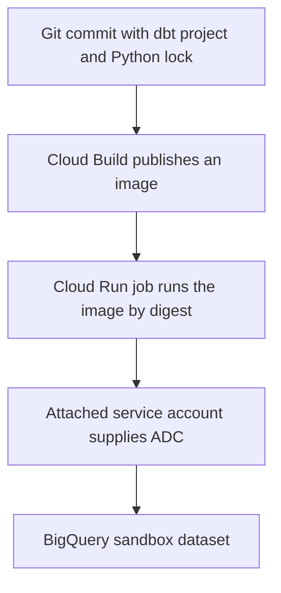

# Package and deploy dbt Core to Cloud Run Jobs

Moving `shop_lab` from DuckDB to BigQuery requires packaging dbt Core v1 and `dbt-bigquery` into a reproducible Linux container image and separating build, deploy, and runtime permissions. This lab reuses [`stg_orders`](0004-adapters-profiles-and-the-local-shop-lab.md) and [`fct_orders`](0006-models-refs-and-project-configuration.md) inside a fresh directory against a GCP sandbox project with billing, Artifact Registry, Cloud Build, Cloud Run, and BigQuery APIs enabled. Always verify your dataset's BigQuery `location` (for example `US` or `EU`), which is independent of the Cloud Run compute region (`us-central1`).



## IAM separation and BigQuery profiles

Keep four identities cleanly scoped by least privilege:

- **Build principal (Cloud Build SA)** needs Artifact Registry Writer on the Docker repo to push images.
- **Deployer** needs Cloud Run Developer or Admin plus `iam.serviceAccounts.actAs` to attach the runtime identity.
- **Runtime service account (`dbt-runtime`)** needs BigQuery Job User (`roles/bigquery.jobUser`) on the compute project, BigQuery Data Editor (`roles/bigquery.dataEditor`) on the target `dbt_lab` dataset, and BigQuery Data Viewer (`roles/bigquery.dataViewer`) on raw source datasets.
- **Trigger principal (Scheduler and Workflows)** needs Cloud Run Invoker (`roles/run.invoker`) only, with zero direct BigQuery write permissions.

In `profiles.yml`, use `method: oauth` so `dbt-bigquery` authenticates via Application Default Credentials (ADC) from Cloud Run's attached service account. Never embed JSON service account keys inside the image. Pass project, dataset, and location via `--set-env-vars` (use Secret Manager `--set-secrets` if any external token is ever needed) and set `maximum_bytes_billed` or `job_execution_timeout_seconds` as cost and runtime guardrails:

```yaml
shop_lab:
  target: gcp
  outputs:
    gcp:
      type: bigquery
      method: oauth
      project: "{{ env_var('DBT_BQ_PROJECT') }}"
      dataset: "{{ env_var('DBT_BQ_DATASET') }}"
      location: "{{ env_var('DBT_BQ_LOCATION') }}"
      threads: 2
      job_execution_timeout_seconds: 900
```

## Practice

### Prepare the sandbox

1. In BigQuery, create dataset `dbt_lab` in location `US` (or choose an approved sandbox dataset and note its exact location).
2. In Artifact Registry, create a Docker repo named `dbt` in `us-central1` and grant Cloud Build's service account Artifact Registry Writer on that repo.
3. Create `dbt-runtime` with the BigQuery roles above, ensuring your deployer can attach it and your user has read access to verify query outputs.
4. In a fresh directory, copy `dbt_project.yml`, `seeds/raw_orders.csv`, `models/stg_orders.sql`, and `models/fct_orders.sql`, and save the BigQuery `profiles.yml` above.

!!! note "Keep the lab isolated"
    Run these commands only in an approved GCP sandbox. The exercise packages `raw_orders.csv` inside the image for a self-contained drill; production projects read external BigQuery source tables via `source()`.

### Build and deploy by immutable digest

5. Pin dependencies in `requirements.in`, then compile an exact Linux `x86_64` lockfile (`uv pip compile --python-version 3.12 --python-platform x86_64-manylinux_2_28 requirements.in -o requirements.txt`). Targeting `x86_64` and building via Cloud Build avoids Apple Silicon ARM64 `exec format error` mismatches on Cloud Run:

```text
dbt-core==1.10.23
dbt-bigquery==1.10.3
```

6. Add `tests/paid_orders_have_positive_total.sql` so lesson 0045 has a deterministic failure gate:

```sql
select order_id, total_cents
from {{ ref('fct_orders') }}
where status = 'paid' and (total_cents is null or total_cents <= 0)
```

7. Create `.gcloudignore` to keep local caches, databases, credentials, and Git history out of Cloud Build uploads:

```text
.git/
.env
target/
logs/
dbt_packages/
*.duckdb
*.json
```

8. Create `Dockerfile`. If your project uses `packages.yml`, copy `packages.yml` and `package-lock.yml` and run `dbt deps` during the Docker build so containers start fast without querying GitHub or Package Hub at runtime:

```dockerfile
FROM python:3.12-slim
WORKDIR /app
COPY requirements.txt ./
RUN pip install --no-cache-dir -r requirements.txt
COPY dbt_project.yml profiles.yml ./
COPY models/ models/
COPY seeds/ seeds/
COPY tests/ tests/
ENTRYPOINT ["dbt"]
CMD ["build", "--profiles-dir", "/app", "--select", "+fct_orders"]
```

9. Build the image, capture its immutable `@DIGEST`, deploy the Cloud Run job, and execute it:

```bash
PROJECT_ID="your-sandbox-project"
REGION="us-central1"
BQ_LOCATION="US"
DATASET="dbt_lab"
JOB="dbt-shop"
RUNTIME_SA="dbt-runtime@${PROJECT_ID}.iam.gserviceaccount.com"
IMAGE="${REGION}-docker.pkg.dev/${PROJECT_ID}/dbt/dbt-shop"
TAG="lab-001"

gcloud builds submit --project="$PROJECT_ID" --tag="${IMAGE}:${TAG}" .
DIGEST=$(gcloud artifacts docker images describe "${IMAGE}:${TAG}" \
  --project="$PROJECT_ID" --format='value(image_summary.digest)')

gcloud run jobs deploy "$JOB" --project="$PROJECT_ID" --region="$REGION" \
  --image="${IMAGE}@${DIGEST}" --service-account="$RUNTIME_SA" \
  --tasks=1 --max-retries=0 --task-timeout=20m \
  --set-env-vars="DBT_BQ_PROJECT=${PROJECT_ID},DBT_BQ_DATASET=${DATASET},DBT_BQ_LOCATION=${BQ_LOCATION}"

gcloud run jobs execute "$JOB" --project="$PROJECT_ID" --region="$REGION" --wait
```

**Local route.** From the fresh project directory, build the same image and parse with placeholder profile values. Docker appends these arguments to the `dbt` entrypoint in place of the default build arguments. A successful parse checks the packaged project. The cloud execution above also exercises BigQuery IAM and warehouse writes.

```bash
docker build --platform linux/amd64 -t dbt-shop:local .
docker run --rm --platform linux/amd64 -e DBT_BQ_PROJECT=example-project \
  -e DBT_BQ_DATASET=dbt_lab -e DBT_BQ_LOCATION=US \
  dbt-shop:local parse --profiles-dir /app
```

10. **Verify in BigQuery.** Run this query in the BigQuery console (substituting your project and dataset):

```sql
select count(*) as order_count, count(distinct order_id) as distinct_orders,
       sum(total_cents) as total_cents,
       sum(if(status = 'paid', total_cents, 0)) as paid_cents
from `your-sandbox-project.dbt_lab.fct_orders`
```

**Expected result.** The job exits 0, `paid_orders_have_positive_total` passes, and BigQuery shows **3** orders, **3** distinct keys, **3,500** total cents, and **3,000** paid cents. Record the execution name and `@DIGEST` for lessons 0043 through 0045.

## Recall

1. Why can an engineer have full permission to deploy and run a Cloud Run job while dbt still fails inside the container with a BigQuery access denied error?
2. Why deploy Cloud Run jobs referencing `${IMAGE}@${DIGEST}` instead of a mutable tag like `:latest`, and why keep `dbt deps` inside the Docker build rather than at job startup?
3. How does `method: oauth` authenticate dbt to BigQuery inside Cloud Run without storing a JSON private key file?

??? note "Answer guidance"
    1. Deployer and invoker IAM permissions govern the Cloud Run control plane, whereas BigQuery authorizes queries using the job's attached `--service-account` (`dbt-runtime`), which needs its own BigQuery Job User and dataset roles.
    2. An image `@DIGEST` is immutable and guarantees exact, auditable rollbacks when restoring a prior release. Running `dbt deps` during image build prevents runtime jobs from failing if Package Hub or GitHub is temporarily unreachable.
    3. `method: oauth` uses Application Default Credentials (ADC), automatically fetching short-lived OAuth tokens from Cloud Run's metadata server for the attached runtime service account.

[BigQuery adapter setup](https://docs.getdbt.com/docs/local/connect-data-platform/bigquery-setup) · [Cloud Run service identity](https://docs.cloud.google.com/run/docs/configuring/jobs/service-identity) · [BigQuery IAM roles](https://docs.cloud.google.com/bigquery/docs/access-control) · [Create Cloud Run jobs](https://docs.cloud.google.com/run/docs/create-jobs)

| Previous | Curriculum | Next |
| --- | --- | --- |
| [Previous lesson](0041-cloud-run-jobs-and-bigquery.md) | [All lessons](index.md) | [Next lesson](0043-schedule-and-orchestrate-gcp-dbt-jobs.md) |
