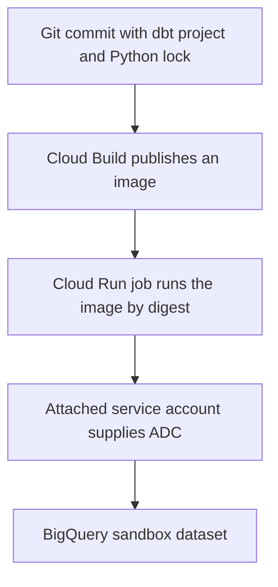

# Package and deploy dbt Core to Cloud Run Jobs

This lab uses dbt Core v1 and the Python BigQuery adapter. It reuses the [shop seed and staging model](0004-adapters-profiles-and-the-local-shop-lab.md) and [order fact](0006-models-refs-and-project-configuration.md) in a fresh directory. Use a sandbox project with billing, a dedicated BigQuery dataset, an Artifact Registry Docker repository, and enabled Cloud Build, Artifact Registry, Cloud Run, and BigQuery APIs. Use the dataset's actual BigQuery location, which can differ from the Cloud Run region.



Assign a dedicated runtime service account. Give it BigQuery Job User on the project where it submits queries, BigQuery Data Editor on the existing destination dataset, and BigQuery Data Viewer on any external source datasets it reads. The deployer needs permission to manage jobs and attach the runtime account. The build principal needs permission to write the image. Keep those identities separate and grant the trigger principal only job invocation permissions.

Replace the DuckDB profile for this copy with a BigQuery profile. With the Core v1 adapter, `method: oauth` uses Application Default Credentials (ADC). On Cloud Run, the Google client library obtains credentials for the attached runtime account. No service account key file is needed.

```yaml
shop_lab:
  target: gcp
  outputs:
    gcp:
      type: bigquery
      method: oauth
      project: "{{ env_var('DBT_BQ_PROJECT') }}"
      dataset: "{{ env_var('DBT_BQ_DATASET') }}"
      location: "{{ env_var('DBT_BQ_LOCATION') }}"
      threads: 2
```

## Practice

### Prepare the sandbox

1. In the BigQuery console, create the `dbt_lab` dataset in `US`, or choose an existing dedicated sandbox dataset and record its location.
2. In Artifact Registry, create a Docker repository named `dbt` in `us-central1`. Confirm which service account Cloud Build will use and grant it Artifact Registry Writer on that repository.
3. Create `dbt-runtime` and grant it the BigQuery permissions described above. Confirm that the deployer can attach it. The identity that verifies the result in BigQuery also needs query and dataset read permissions.
4. Copy `dbt_project.yml`, `seeds/raw_orders.csv`, `models/stg_orders.sql`, and `models/fct_orders.sql` from the earlier lessons into the dedicated directory. Save the BigQuery profile shown above as `profiles.yml`.

!!! note "Keep the lab isolated"
    Run these commands in a project where BigQuery and Cloud Run spending is approved. The Docker image includes the seed data. Use the synthetic fixture for this exercise.

### Build a testable image

Create `requirements.in` with these direct dependencies. Run `uv pip compile --python-version 3.12 --python-platform x86_64-manylinux_2_28 requirements.in -o requirements.txt` to resolve the lock for the Linux image.

```text
dbt-core==1.10.23
dbt-bigquery==1.10.3
```

Add the following singular data test as `tests/paid_orders_have_positive_total.sql`. It passes for the original fixture and gives the [failure drill](0045-gcp-serverless-dbt-capstone.md) a predictable way to fail the build.

```sql
select order_id, total_cents
from {{ ref('fct_orders') }}
where status = 'paid' and (total_cents is null or total_cents <= 0)
```

Use this Dockerfile in the sandbox dbt project. Make the project entry point run a scoped build that includes the seed. For an ingestion-backed production project, use source definitions and an intentional production selector.

```dockerfile
FROM python:3.12-slim
WORKDIR /app
COPY requirements.txt ./
RUN pip install --no-cache-dir -r requirements.txt
COPY dbt_project.yml profiles.yml ./
COPY models/ models/
COPY seeds/ seeds/
COPY tests/ tests/
ENTRYPOINT ["dbt", "build", "--profiles-dir", "/app", "--select", "+fct_orders"]
```

Before uploading the build context, exclude local credential files, logs, `target/`, and embedded databases using `.gcloudignore`. Use a revision tag for Cloud Build, then deploy its immutable digest.

```bash
PROJECT_ID="your-sandbox-project"
REGION="us-central1"
BQ_LOCATION="US"
DATASET="dbt_lab"
JOB="dbt-shop"
RUNTIME_SA="dbt-runtime@${PROJECT_ID}.iam.gserviceaccount.com"
IMAGE="${REGION}-docker.pkg.dev/${PROJECT_ID}/dbt/dbt-shop"
TAG="lab-001"

gcloud builds submit --project="$PROJECT_ID" --tag="${IMAGE}:${TAG}" .
DIGEST=$(gcloud artifacts docker images describe "${IMAGE}:${TAG}" \
  --project="$PROJECT_ID" --format='value(image_summary.digest)')

gcloud run jobs deploy "$JOB" --project="$PROJECT_ID" --region="$REGION" \
  --image="${IMAGE}@${DIGEST}" --service-account="$RUNTIME_SA" \
  --tasks=1 --max-retries=0 --task-timeout=20m \
  --set-env-vars="DBT_BQ_PROJECT=${PROJECT_ID},DBT_BQ_DATASET=${DATASET},DBT_BQ_LOCATION=${BQ_LOCATION}"

gcloud run jobs execute "$JOB" --project="$PROJECT_ID" --region="$REGION" --wait
```

**Expected result.** The execution succeeds and the paid-order test passes. From the BigQuery console, query the sandbox fact. Replace the project and dataset in the table name with your values.

```sql
select count(*) as order_count, count(distinct order_id) as distinct_orders,
       sum(total_cents) as total_cents,
       sum(if(status = 'paid', total_cents, 0)) as paid_cents
from `your-sandbox-project.dbt_lab.fct_orders`
```

Expect three orders, three distinct keys, 3,500 total cents and 3,000 paid cents. Record the execution name and image digest. If BigQuery returns an access or location error, compare the job's attached identity, dataset grants and configured location with the query job details. Keep the sandbox for the rest of the module if you plan to run the capstone.

## Recall

Why can a principal deploy and execute the job but still see a BigQuery access error during execution?

??? note "Answer guidance"

    BigQuery authorizes the runtime service account. Deployment and job invocation permissions belong to control-plane identities and do not grant BigQuery data access.

[BigQuery adapter setup](https://docs.getdbt.com/docs/local/connect-data-platform/bigquery-setup) · [Cloud Run service identity](https://docs.cloud.google.com/run/docs/configuring/jobs/service-identity) · [BigQuery IAM roles](https://docs.cloud.google.com/bigquery/docs/access-control) · [Create Cloud Run jobs](https://docs.cloud.google.com/run/docs/create-jobs)

| Previous | Curriculum | Next |
| --- | --- | --- |
| [Previous lesson](0041-cloud-run-jobs-and-bigquery.md) | [All lessons](index.md) | [Next lesson](0043-schedule-and-orchestrate-gcp-dbt-jobs.md) |
