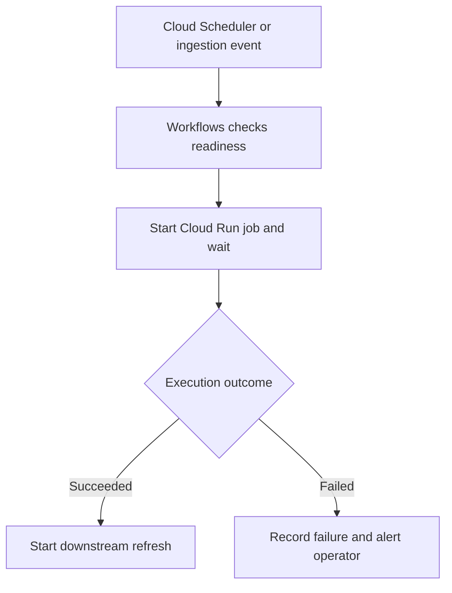

# Schedule and orchestrate dbt on GCP

A Scheduler HTTP target can send an OAuth-authenticated POST to the Cloud Run Jobs API. This request starts an execution. A successful Scheduler delivery means the API accepted the start request. Check the execution separately to know whether dbt finished successfully.

Use Workflows if a later job must wait for dbt success, or if you need to check an ingestion watermark and conditionally proceed. The Cloud Run v2 connector polls the long-running operation by default. Eventarc can start a workflow after an upstream event. Treat duplicate delivery and overlapping manual runs as possibilities in either design.



## Practice

### Trigger a job on a schedule

Enable the Cloud Scheduler API. Create the `dbt-scheduler` service account in the same project as the schedule. The principal creating the schedule must be able to attach that account. Reuse the variables from the [deployment lesson](0042-build-and-deploy-dbt-to-cloud-run.md).

```bash
SCHEDULER_SA="dbt-scheduler@${PROJECT_ID}.iam.gserviceaccount.com"

gcloud run jobs add-iam-policy-binding "$JOB" \
  --project="$PROJECT_ID" --region="$REGION" \
  --member="serviceAccount:${SCHEDULER_SA}" --role="roles/run.invoker"

gcloud scheduler jobs create http dbt-shop-daily \
  --project="$PROJECT_ID" --location="$REGION" \
  --schedule="0 6 * * *" --time-zone="Etc/UTC" \
  --uri="https://run.googleapis.com/v2/projects/${PROJECT_ID}/locations/${REGION}/jobs/${JOB}:run" \
  --http-method=POST --oauth-service-account-email="$SCHEDULER_SA" \
  --headers="Content-Type=application/json" --message-body='{}'

gcloud scheduler jobs run dbt-shop-daily --project="$PROJECT_ID" --location="$REGION"
gcloud run jobs executions list --job="$JOB" --project="$PROJECT_ID" --region="$REGION"
```

Allow time for delivery, then match the new execution to the request timestamp and verify the final status. Pause the schedule before moving to the workflow lab.

### Wait for dbt with Workflows

Enable the Workflows and Workflow Executions APIs. Create a `dbt-workflow` service account with Cloud Run Invoker on the job and permission to read the execution and long-running operation. In a dedicated sandbox, project-level Cloud Run Viewer supplies read permissions. Save this example as `workflow.yaml`. Set the connector timeout above the job's expected runtime, including retry time.

```yaml
main:
  params: [args]
  steps:
    - build_models:
        call: googleapis.run.v2.projects.locations.jobs.run
        args:
          name: ${args.job_name}
          connector_params:
            timeout: 1800
        result: execution
    - mark_ready:
        return:
          status: ready
          execution: ${execution.name}
```

```bash
WORKFLOW_SA="dbt-workflow@${PROJECT_ID}.iam.gserviceaccount.com"

gcloud scheduler jobs pause dbt-shop-daily --project="$PROJECT_ID" --location="$REGION"
gcloud workflows deploy dbt-shop-gate --project="$PROJECT_ID" --location="$REGION" \
  --source=workflow.yaml --service-account="$WORKFLOW_SA"
gcloud workflows run dbt-shop-gate --project="$PROJECT_ID" --location="$REGION" \
  --data="{\"job_name\":\"projects/${PROJECT_ID}/locations/${REGION}/jobs/${JOB}\"}"
```

**Expected result.** On success, the workflow returns `ready` and the Cloud Run execution resource name. Use the [capstone](0045-gcp-serverless-dbt-capstone.md) to verify that the ready step is skipped when dbt fails. For a production ingestion event, use Eventarc to start the workflow and adapt its event envelope to extract the data interval and choose the correct job. Keep the runtime account and trigger account separate.

!!! tip "Coordinate overlapping executions"
    Setting one task per execution still allows distinct executions to overlap. Start with a single trigger path. If distinct data intervals share a write target, serialize conflicting writes and make reprocessing the same interval safe.

## Recall

Why can Scheduler show a successful attempt while the dashboard remains stale?

??? note "Answer guidance"

    Scheduler records delivery to the control-plane endpoint. The job can fail after it starts. Observe Cloud Run execution status and BigQuery results, or use Workflows to gate downstream work on completion.

[Schedule Cloud Run jobs](https://docs.cloud.google.com/run/docs/execute/jobs-on-schedule) · [Cloud Run Workflows connector](https://docs.cloud.google.com/workflows/docs/reference/googleapis/run/v2/projects.locations.jobs/run) · [Create workflows](https://docs.cloud.google.com/workflows/docs/creating-updating-workflow) · [Execute a workflow](https://docs.cloud.google.com/workflows/docs/executing-workflow)

| Previous | Curriculum | Next |
| --- | --- | --- |
| [← Previous lesson](0042-build-and-deploy-dbt-to-cloud-run.md) | [All lessons](index.md) | [Next lesson →](0044-operate-and-recover-gcp-dbt-jobs.md) |
