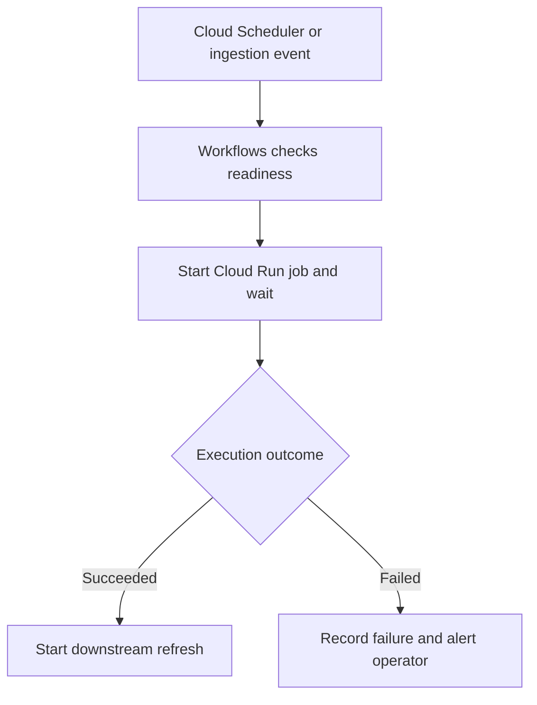

# Schedule and orchestrate dbt on GCP

Deploying a Cloud Run job manually with `gcloud run jobs execute` tests the image; production pipelines need automated scheduling or ingestion-driven triggers. Google Cloud separates **starting a job** (Cloud Scheduler) from **waiting for completion, checking upstream inputs, and handling errors** (Cloud Workflows + Eventarc).

## Choosing between Scheduler and Workflows + Eventarc

- **Cloud Scheduler** sends an OAuth-authenticated HTTP `POST` to the Cloud Run Jobs `:run` API on a cron timer. Remember that HTTP `200` from Scheduler only proves the API accepted the start request, **not** that dbt built your tables! Set `--max-retry-attempts=0` when duplicate job triggers on transient network timeouts could overlap writes.
- **Cloud Workflows** calls `googleapis.run.v2.projects.locations.jobs.run`, automatically polls the long-running operation until dbt exits, and only continues to downstream steps (such as refreshing BI extracts) when dbt succeeds. Wrap the job call in `try / except` when you want to post custom failure alerts or execute cleanup instead of aborting immediately.
- **Eventarc** triggers a Workflow automatically on upstream events (such as a Cloud Storage file upload finalizing or a Pub/Sub message from your ingestion pipeline), passing event metadata so Workflows can pass **container overrides** (`args` or `env`, such as `--select +fct_orders` or `--full-refresh`) at runtime without rebuilding the Docker image!



## Practice

**Without a GCP sandbox**, trace the workflow below twice on paper. On the first run the API accepts the request and the job finishes successfully. On the second the API accepts it but dbt exits 1. Mark the last step reached on each path. Only the first trace should reach `mark_ready`.

### Trigger on a schedule with Cloud Scheduler

1. Enable the Cloud Scheduler API, create `dbt-scheduler`, grant it `roles/run.invoker` on the job from [lesson 0042](0042-build-and-deploy-dbt-to-cloud-run.md), and create + trigger a daily UTC schedule:

```bash
SCHEDULER_SA="dbt-scheduler@${PROJECT_ID}.iam.gserviceaccount.com"

gcloud run jobs add-iam-policy-binding "$JOB" \
  --project="$PROJECT_ID" --region="$REGION" \
  --member="serviceAccount:${SCHEDULER_SA}" --role="roles/run.invoker"

gcloud scheduler jobs create http dbt-shop-daily \
  --project="$PROJECT_ID" --location="$REGION" \
  --schedule="0 6 * * *" --time-zone="Etc/UTC" \
  --uri="https://run.googleapis.com/v2/projects/${PROJECT_ID}/locations/${REGION}/jobs/${JOB}:run" \
  --max-retry-attempts=0 --http-method=POST --oauth-service-account-email="$SCHEDULER_SA" \
  --headers="Content-Type=application/json" --message-body='{}'

gcloud scheduler jobs run dbt-shop-daily --project="$PROJECT_ID" --location="$REGION"
gcloud run jobs executions list --job="$JOB" --project="$PROJECT_ID" --region="$REGION"
```

Verify the new execution timestamp matches your trigger and finishes cleanly, then pause the schedule before starting the Workflows step.

### Wait for completion with Workflows

2. Enable the Workflows and Workflow Executions APIs. Create `dbt-workflow` with `roles/run.invoker` on the job plus read access on executions/operations (`roles/run.viewer` in a dedicated sandbox). Save `workflow.yaml` (setting `connector_params.timeout` above your Cloud Run `--task-timeout`):

```yaml
main:
  params: [args]
  steps:
    - build_models:
        try:
          call: googleapis.run.v2.projects.locations.jobs.run
          args:
            name: ${args.job_name}
            connector_params:
              timeout: 1800
          result: execution
        except:
          as: err
          steps:
            - notify_failure:
                raise: ${err}
    - mark_ready:
        return:
          status: ready
          execution: ${execution.name}
```

To override arguments for one execution, pass `body: {overrides: {containerOverrides: [{args: ["build", "--profiles-dir", "/app", "--select", "fct_orders"]}]}}` inside the connector `args:`. Include the `build` subcommand because these arguments replace the image's entire `CMD`. The caller needs `run.jobs.runWithOverrides` on the job for this variant. [Execute jobs with overrides](https://docs.cloud.google.com/run/docs/execute/jobs)

3. Pause the cron schedule, deploy, and execute the workflow:

```bash
WORKFLOW_SA="dbt-workflow@${PROJECT_ID}.iam.gserviceaccount.com"

gcloud scheduler jobs pause dbt-shop-daily --project="$PROJECT_ID" --location="$REGION"
gcloud workflows deploy dbt-shop-gate --project="$PROJECT_ID" --location="$REGION" \
  --source=workflow.yaml --service-account="$WORKFLOW_SA"
gcloud workflows run dbt-shop-gate --project="$PROJECT_ID" --location="$REGION" \
  --data="{\"job_name\":\"projects/${PROJECT_ID}/locations/${REGION}/jobs/${JOB}\"}"
```

**Expected result.** On success, Workflows waits for dbt to exit 0 and outputs `status: ready` alongside the Cloud Run execution resource name. Notice `try / except` lets you insert custom alerting before re-raising the error, ensuring `mark_ready` never runs when dbt fails (tested live in [lesson 0045](0045-gcp-serverless-dbt-capstone.md)).

!!! tip "Coordinate overlapping executions"
    Setting `--tasks=1` prevents duplicate containers within *one* execution, yet two separate triggers (such as Scheduler firing while a manual backfill runs) can still launch overlapping executions concurrently. Serialize triggers writing to the same tables and keep reprocessing idempotent.

## Recall

1. Why can Cloud Scheduler report a green `Success` delivery attempt while `fct_orders` remains un-updated or broken in BigQuery?
2. How does Cloud Workflows know when to stop waiting before proceeding to `mark_ready`, and what happens if `build_models` fails inside the `try` block?
3. How can you run a one-off `--full-refresh` or custom `--select` on a deployed Cloud Run dbt job without building and pushing a brand-new Docker image?

??? note "Answer guidance"
    1. Scheduler only records whether the Cloud Run Jobs HTTP `:run` endpoint accepted the trigger request; dbt can fail later inside the container or in BigQuery. Check the Cloud Run execution status or wrap the job in Workflows.
    2. The `googleapis.run.v2...jobs.run` connector polls the long-running Cloud Run operation until the execution finishes. If dbt exits nonzero, control enters `except` (handling/alerting and re-raising) and skips `mark_ready`.
    3. Pass `overrides.containerOverrides` (custom CLI `args` or environment variables) in the Cloud Run Jobs API or Workflows execution payload.

[Schedule Cloud Run jobs](https://docs.cloud.google.com/run/docs/execute/jobs-on-schedule) · [Cloud Run Workflows connector](https://docs.cloud.google.com/workflows/docs/reference/googleapis/run/v2/projects.locations.jobs/run) · [Create workflows](https://docs.cloud.google.com/workflows/docs/creating-updating-workflow) · [Execute a workflow](https://docs.cloud.google.com/workflows/docs/executing-workflow)

| Previous | Curriculum | Next |
| --- | --- | --- |
| [Previous lesson](0042-build-and-deploy-dbt-to-cloud-run.md) | [All lessons](index.md) | [Next lesson](0044-operate-and-recover-gcp-dbt-jobs.md) |
