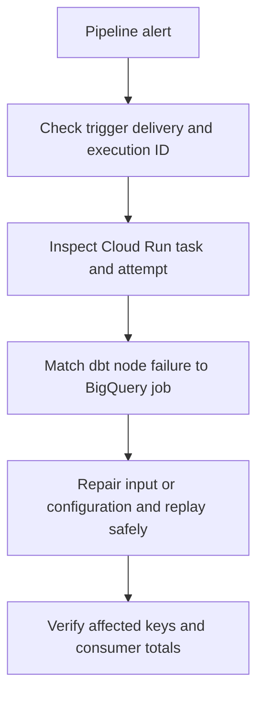

# Operate, retry, and recover serverless dbt builds

When a scheduled GCP dbt pipeline alerts, debug layer by layer from trigger through Cloud Run execution and dbt task logs and artifacts down to BigQuery jobs. A container launch error (such as bad Artifact Registry IAM) happens before dbt ever parses YAML, whereas a failing data test commits upstream BigQuery tables first. Pin down the first failing layer before retrying anything.



## Triage table by failure layer

| Symptom | Where to check first |
| --- | --- |
| **Scheduler returns `403`** | Verify OAuth token, exact job resource path, and `roles/run.invoker` on `dbt-scheduler`. |
| **Container fails to start** | Run `executions describe` and inspect conditions, image `@DIGEST`, and `dbt-runtime` / Cloud Run Artifact Registry access. |
| **BigQuery rejects query** | Check `dbt-runtime` IAM roles, billing project, and `DBT_BQ_LOCATION` matching the dataset location. |
| **Timeout or container OOM** | Check BigQuery `INFORMATION_SCHEMA.JOBS` (using dbt `query-comment` with `invocation_id` and `CLOUD_RUN_EXECUTION`) to separate BigQuery slot queuing/scans from container parse RAM. Set `maximum_bytes_billed` in `profiles.yml` to block runaway scans. |
| **Job passes yet dashboard stays stale** | Check source freshness, selector scope, and incremental lookback watermarks against raw source rows. |

## Preserving ephemeral artifacts and choosing retry behavior

Because Cloud Run's disk disappears on exit, ship `target/manifest.json`, `target/run_results.json`, and `logs/dbt.log` to a Cloud Storage bucket keyed by Cloud Run's built-in environment variables (`CLOUD_RUN_EXECUTION`, `CLOUD_RUN_TASK_INDEX`, `CLOUD_RUN_TASK_ATTEMPT`) before exiting. Preserve dbt's exit status so Workflows still catches failures:

```bash
#!/usr/bin/env bash
set +e
dbt build --profiles-dir /app --select +fct_orders
EXIT_CODE=$?
gsutil -m cp target/manifest.json target/run_results.json \
  "gs://${ARTIFACT_BUCKET}/runs/${CLOUD_RUN_EXECUTION}/${CLOUD_RUN_TASK_ATTEMPT}/" || true
exit "$EXIT_CODE"
```

Distinguish **Cloud Run `--max-retries`** from **`dbt retry`**: Cloud Run task retries restart the entire container command from scratch (risking duplicate writes on append models or hooks if not idempotent), whereas `dbt retry` resumes only unbuilt/failed nodes using a preserved `run_results.json` (useful interactively or with restored artifacts). Keep `--max-retries=0` unless every selected write and hook is strictly idempotent.

## Practice

### Steps

1. Grab the short execution name from your workflow output or `gcloud run jobs executions list`, then inspect its conditions and container logs:

```bash
EXECUTION="replace-with-execution-name"
gcloud run jobs executions describe "$EXECUTION" \
  --project="$PROJECT_ID" --region="$REGION" --format=yaml
gcloud logging read \
  "resource.type=\"cloud_run_job\" AND labels.\"run.googleapis.com/execution_name\"=\"$EXECUTION\"" \
  --project="$PROJECT_ID" --freshness=1h --limit=50 --order=asc
```

2. Design a production runbook entry covering:
   - Run correlation keys: Cloud Run `execution_name`, `CLOUD_RUN_TASK_ATTEMPT`, immutable image `@DIGEST`, dbt `invocation_id`, data interval, and BigQuery `job_id` (linked via `query-comment` in `dbt_project.yml`).
   - Ephemeral artifact retention: uploading to GCS per `${CLOUD_RUN_EXECUTION}/${CLOUD_RUN_TASK_ATTEMPT}` so retries never overwrite attempt 0 failure evidence, and updating the shared Slim CI baseline only after a validated `0` exit.
   - BigQuery recovery: adapt [lesson 0040](0040-capstone-incident-drill-and-portfolio-review.md)'s late-correction drill to BigQuery partitioned tables (bounded partition overwrite or `merge`, serialized against cron runs, verified by key reconciliation and totals).

**Expected result.** Your runbook traces failures across all four layers, locates prior known-good digests and data intervals, and verifies repairs via key diffs and revenue totals.

## Recall

1. Why must each Cloud Run task attempt upload `manifest.json` and `run_results.json` to a unique path (`${CLOUD_RUN_EXECUTION}/${CLOUD_RUN_TASK_ATTEMPT}`) rather than overwriting a shared `latest/` path?
2. How can an operator link a slow or timed-out Cloud Run dbt execution to the exact BigQuery SQL query consuming slots?
3. Why did the wrapper script capture `EXIT_CODE=$?` before running `gsutil cp` and end with `exit "$EXIT_CODE"`?

??? note "Answer guidance"
    1. Overwriting a shared path destroys the failed attempt's `run_results.json` and `manifest.json` needed for root-cause analysis, and can corrupt a Slim CI baseline with unbuilt code. Keying by execution and attempt isolates every run's evidence.
    2. Configure `query-comment` in `dbt_project.yml` to embed dbt `invocation_id`, model `node_id`, and `CLOUD_RUN_EXECUTION` into SQL comments, then inspect BigQuery `INFORMATION_SCHEMA.JOBS` to separate BigQuery execution/slot wait from container runtime.
    3. If `gsutil cp` ran without saving `$?`, its exit code `0` would mask dbt's failure and trick Cloud Run and Workflows into marking a broken build green.

[Cloud Run retry guidance](https://docs.cloud.google.com/run/docs/jobs-retries) · [Job execution details](https://docs.cloud.google.com/run/docs/managing/job-executions) · [Cloud Run log labels](https://docs.cloud.google.com/logging/docs/api/platform-logs#run) · [dbt artifacts](https://docs.getdbt.com/reference/artifacts/dbt-artifacts)

| Previous | Curriculum | Next |
| --- | --- | --- |
| [Previous lesson](0043-schedule-and-orchestrate-gcp-dbt-jobs.md) | [All lessons](index.md) | [Next lesson](0045-gcp-serverless-dbt-capstone.md) |
