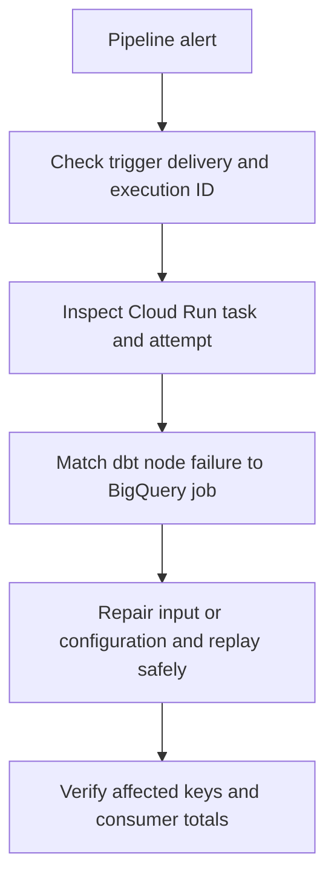

# Operate, retry, and recover serverless dbt builds

Trace a failure by plane. Check Scheduler delivery or the workflow execution first, then the Cloud Run execution, then dbt task logs and the BigQuery job. A job can fail before its container starts, for example because of image access. A data test can fail after upstream BigQuery writes already succeeded. Use dbt node outcomes and warehouse evidence to choose the smallest safe recovery.



| Symptom | Check |
| --- | --- |
| Scheduler gets a 403 | Confirm OAuth, target job resource, and invoker binding on the scheduler identity. |
| Job cannot launch its container | Check the execution's conditions, image digest, and Artifact Registry access. |
| BigQuery rejects a query | Inspect the runtime identity, dataset permissions, billing project and data location. |
| Task times out or hits memory limits | Separate warehouse queuing and query time from local dbt compilation. Check the BigQuery job state before replaying. |
| Job succeeds with stale output | Verify ingestion freshness, node selection and incremental watermarks. Compare the serving table against an independent query. |

## Practice

From the sandbox, copy the short execution name from the Cloud Run Jobs console or the workflow output. Inspect the status and read the logs for that exact execution.

```bash
EXECUTION="replace-with-execution-name"
gcloud run jobs executions describe "$EXECUTION" \
  --project="$PROJECT_ID" --region="$REGION" --format=yaml
gcloud logging read \
  "resource.type=\"cloud_run_job\" AND labels.\"run.googleapis.com/execution_name\"=\"$EXECUTION\"" \
  --project="$PROJECT_ID" --freshness=1h --limit=50 --order=asc
```

Design a run record containing the Cloud Run execution name, task attempt, image digest, dbt invocation ID, data interval, and BigQuery job IDs where available. Use Cloud Logging for container output. For durable state and investigation, publish selected artifacts such as `manifest.json` and `run_results.json` to a protected Cloud Storage path per execution and attempt before exit. Persist a baseline separately from the working `target/` directory and preserve dbt's exit status when uploading. The instance filesystem is ephemeral.

Use the [late-correction scenario](0040-capstone-incident-drill-and-portfolio-review.md) as a recovery exercise. Plan the BigQuery version of a bounded partition or key-based replay, including overlap prevention and consumer reconciliation. Compare Cloud Run task retries, which restart the command, with dbt retry, which needs run state and compatible code and configuration. Add task retries only after verifying that reruns are safe. Keep separate controls for timeouts, Cloud Run task resources, dbt threads, and BigQuery query costs.

**Expected result.** Your runbook can identify the first failing layer, name the prior successful image and data interval, and verify a recovery by comparing both affected keys and the paid total. For a live sandbox, start with an intentional low-impact test failure and retain the artifacts from both the failed execution and the recovery.

## Recall

Why should a retry avoid reusing the same artifact path as the initial attempt?

??? note "Answer guidance"

    The second attempt can overwrite the evidence needed to diagnose the first. Key artifacts by execution, task, and attempt. Advance the shared baseline only after a successful, validated run.

[Cloud Run retry guidance](https://docs.cloud.google.com/run/docs/jobs-retries) · [Job execution details](https://docs.cloud.google.com/run/docs/managing/job-executions) · [Cloud Run log labels](https://docs.cloud.google.com/logging/docs/api/platform-logs#run) · [dbt artifacts](https://docs.getdbt.com/reference/artifacts/dbt-artifacts)

| Previous | Curriculum | Next |
| --- | --- | --- |
| [← Previous lesson](0043-schedule-and-orchestrate-gcp-dbt-jobs.md) | [All lessons](index.md) | [Next lesson →](0045-gcp-serverless-dbt-capstone.md) |
