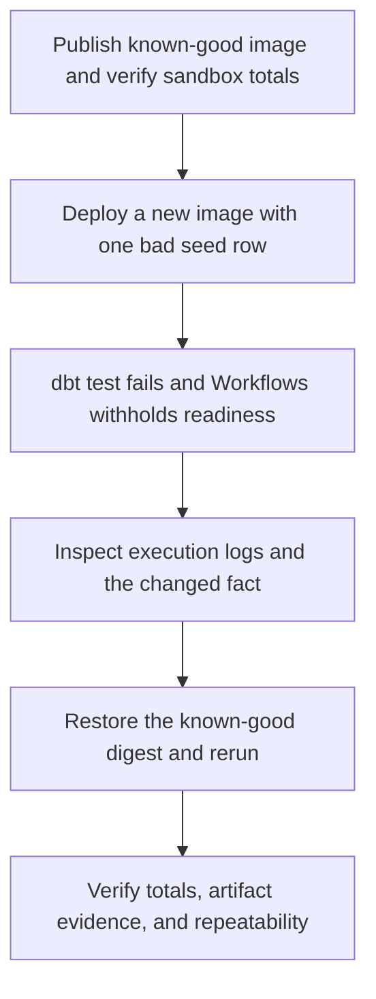

# Ship and recover a dbt job on GCP

In this final capstone, you run the serverless BigQuery pipeline end to end through three stages: a known-good baseline release, a failing data test caused by bad input data, and a safe rollback to the known-good immutable image digest. Use the test-enabled image from [lesson 0042](0042-build-and-deploy-dbt-to-cloud-run.md) and the Workflows gate from [lesson 0043](0043-schedule-and-orchestrate-gcp-dbt-jobs.md), keeping the Cloud Scheduler cron paused during the drill.

## Practice

### Establish a known-good baseline

Execute `dbt-shop-gate` against your initial `lab-001` image. Save the image `@DIGEST`, the Workflows execution ID, and the Cloud Run execution name. Run the BigQuery verification query from lesson 0042 and confirm **3 distinct orders**, **3,500 total cents**, and **3,000 paid cents**.

### Trigger a failing data check

1. Edit `seeds/raw_orders.csv` to set paid order 1's `total_cents` to `0` (keeping `order_id=1` and `status=paid`). Build and deploy a new tag (`lab-002`) while keeping your `lab-001` `@DIGEST` saved separately.
2. Execute the `dbt-shop-gate` workflow again. Confirm Cloud Run fails on `paid_orders_have_positive_total` and Workflows aborts without returning `status: ready`.
3. Inspect the failed execution with `gcloud logging read` from [lesson 0044](0044-operate-and-recover-gcp-dbt-jobs.md) to find the failing test node, then query BigQuery `dbt_lab.fct_orders`.

**Expected finding.** BigQuery now holds **2,250 total cents** and **1,750 paid cents**! Even though Workflows refused to advance downstream jobs, `dbt build` materialized `fct_orders` *before* running its test, so any dashboard querying `dbt_lab.fct_orders` directly sees broken rows.

!!! tip "Prevent partial bad publishes with Write-Audit-Publish (WAP)"
    If live BI tools query production tables directly, build and test models inside an isolated candidate dataset (`dbt_lab_staging`), then atomically promote tested tables (`CREATE OR REPLACE TABLE ... CLONE` in BigQuery or a blue-green view swap) into the reader-facing dataset only after every test passes.

### Roll back, reconcile, and prove idempotency

1. Redeploy the Cloud Run job pinned back to your saved `lab-001` `@DIGEST`.
2. Execute `dbt-shop-gate` **twice** on the restored digest. Confirm both executions exit `0` and return `status: ready` with distinct Cloud Run execution names.
3. Re-query BigQuery after each run and verify **3 distinct orders**, **3,500 total cents**, and **3,000 paid cents** both times.

**Decide when to reopen the dashboard.** Identify the first point when a direct reader can safely query the restored fact. Updating the image leaves the failed run's rows in BigQuery. After the rebuild, compare the three order IDs and amounts with the baseline and confirm the paid sum. For a production source outside the image, also verify the input correction: rolling back code alone cannot restore a bad source row.

### Handoff and cleanup

Write a brief release postmortem recording both `@DIGEST` values, execution IDs, BigQuery before/after totals, and why the failed run modified `fct_orders`. Sketch how the exact same image, `dbt-runtime` identity, and readiness gate would map onto Cloud Composer or Google Cloud Batch. Then delete the Cloud Scheduler job, Workflow, Cloud Run job, Artifact Registry images, and `dbt_lab` dataset to avoid unintended billing.

**Local DuckDB alternative (no GCP account).** Run `dbt build --profiles-dir . --select +fct_orders` in [shop_lab](0004-adapters-profiles-and-the-local-shop-lab.md) with `tests/paid_orders_have_positive_total.sql` on the valid seed (`3,500` / `3,000`), on the `total_cents=0` seed (fails test while `fct_orders` writes `2,250` / `1,750`), and twice after restoring (`3,500` / `3,000`), and diagram how Workflows gates downstream runs on Cloud Run completion.

## Recall

1. Why does redeploying the known-good `lab-001` image `@DIGEST` not immediately restore `fct_orders` until another execution finishes?
2. Workflows stopped without returning `ready`, so downstream batch exports stayed safe. Why did BigQuery `dbt_lab.fct_orders` still show `1,750` paid cents, and how does Write-Audit-Publish (WAP) prevent live dashboards from reading it?
3. When handing this containerized dbt job off from Cloud Run Jobs + Workflows to Cloud Composer, which three security and execution contracts must remain intact?

??? note "Answer guidance"
    1. Updating the Cloud Run job definition only changes what image *future* executions run; the prior failing execution already overwrote `fct_orders` in BigQuery. You must execute the restored digest and reconcile row and aggregate checks.
    2. `dbt build` runs `fct_orders` before running `paid_orders_have_positive_total`, so bad rows commit before the test fails. With WAP, dbt builds and tests inside an isolated candidate dataset and promotes/clones into the dashboard dataset only after all tests pass.
    3. Keep the immutable image `@DIGEST` and `ENTRYPOINT`, retain the least-privilege `dbt-runtime` BigQuery service account, and preserve an explicit success check plus artifact capture before downstream DAG tasks run.

| Previous | Curriculum | Next |
| --- | --- | --- |
| [Previous lesson](0044-operate-and-recover-gcp-dbt-jobs.md) | [All lessons](index.md) | |
