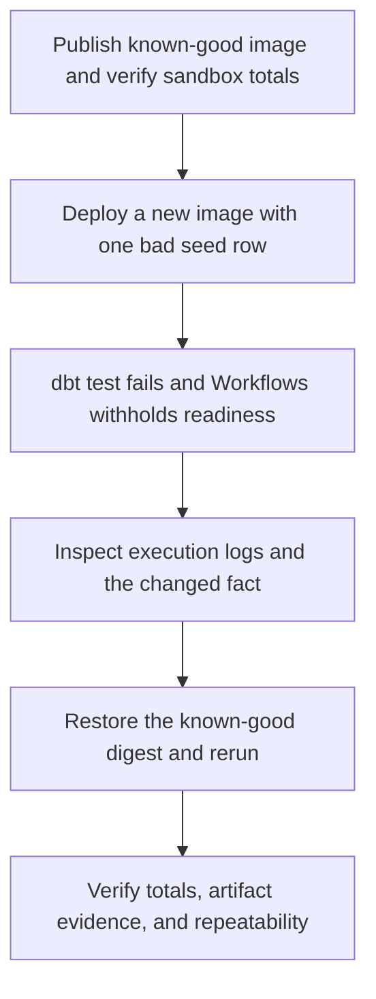

# Ship and recover a dbt job on GCP

Run the shop pipeline through a successful release, a failed data test, and a recovery. Use the test-enabled image from [lesson 0042](0042-build-and-deploy-dbt-to-cloud-run.md) and the Workflows gate from [lesson 0043](0043-schedule-and-orchestrate-gcp-dbt-jobs.md). Keep the schedule paused for the drill.

## Practice

### Establish a baseline

Run the workflow on the original image. Save the image digest, the workflow execution ID, and the Cloud Run execution name. Run the BigQuery reconciliation from lesson 0042. Expect **three distinct orders, 3,500 total cents and 3,000 paid cents**.

### Break the data check

1. Set `total_cents` for paid order 1 to `0` in the CSV, leaving its key and status intact. Repeat the image build and deployment with a new tag. Retain the original digest separately for rollback.
2. Run the same workflow. Expect the dbt job to fail on `paid_orders_have_positive_total`, and the workflow to finish without returning `ready`.
3. Inspect the failed execution in Cloud Run and use the [log filter](0044-operate-and-recover-gcp-dbt-jobs.md) to find the failing dbt node. Query the sandbox fact. Expect **2,250 total cents and 1,750 paid cents** because the model write came before the test. Consumers that wait for the workflow proceed only after a passing build. Dashboards querying a live target directly can still see the written rows.

### Recover and verify

Restore the original image digest in the job deployment command from lesson 0042. Run the workflow twice with the original input. Both executions should return `ready` with distinct execution names. Verify three unique keys and totals of **3,500 and 3,000 cents** after each run. Record which data changed and who needs to verify the serving result.

!!! tip "Choose the production publish boundary"
    If any consumer can query a partially updated fact, build and test in an isolated candidate dataset. Promote the vetted result using a reviewed promotion step and give readers access to the published dataset.

### Hand off and clean up

Write a short release record with the image digests, execution IDs, BigQuery totals, and the reason the failed build wrote data. Describe what would change if the job were invoked by a Cloud Composer DAG or moved to Google Cloud Batch. Keep the image entry point, BigQuery runtime identity, and success check explicit in each design. After retaining the evidence you need, delete the schedule, workflow, job, and dedicated sandbox resources you created. Check billing and artifact retention in the sandbox project.

**Local walkthrough.** With the [DuckDB fixture](0004-adapters-profiles-and-the-local-shop-lab.md), add the fact and singular test from lesson 0042 and run `dbt build --profiles-dir . --select +fct_orders` on the original and modified seeds. In local SQL, use `sum(case when status = 'paid' then total_cents else 0 end)` for paid cents. Restore the original CSV and rerun twice. Record the same totals and expected pass/fail/pass outcomes. Draw how the workflow waits for the Cloud Run execution before it reports readiness.

## Recall

Why does rolling back the image require another execution and reconciliation?

??? note "Answer guidance"

    Updating the Cloud Run job changes the image for future executions. The prior run may already have written BigQuery tables. A successful build with the known-good input plus row and aggregate checks confirms the data was repaired.

| Previous | Curriculum | Next |
| --- | --- | --- |
| [Previous lesson](0044-operate-and-recover-gcp-dbt-jobs.md) | [All lessons](index.md) | |
