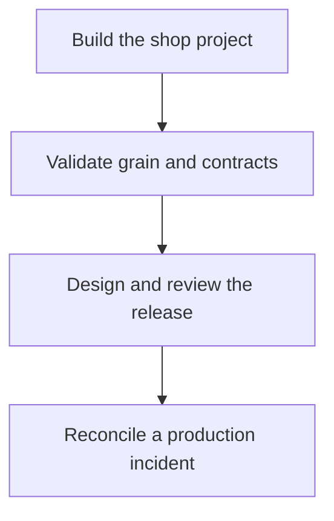

# Learning mission

## Why

Many analytics incidents start with a model whose grain, dependencies, or freshness assumptions were unclear. This course uses one evolving shop project to practice shipping transformations whose outputs other teams can trust and maintain.

## Success looks like

- Build reproducible staging and fact models, document grain and validate keys and business rules.
- Explain the execution path from parse and compile through the adapter, warehouse and artifacts.
- Design a safe release with separate developer, CI and production schemas, then diagnose a missed update.
- Publish a consistent metric and explain which dbt project and team own the model behind it.
- Choose and justify a package, an observability signal, and a CI policy for the project.

## Constraints

The central lab uses self-hosted dbt and a local DuckDB file. Managed exercises require appropriate platform access or can be completed as design walkthroughs. Match examples to the engine and adapter version in use.

## Out of scope

The capstone assumes an upstream ingestion system and focuses on transformations and their consumers.

[Open the curriculum](lessons/index.md)
