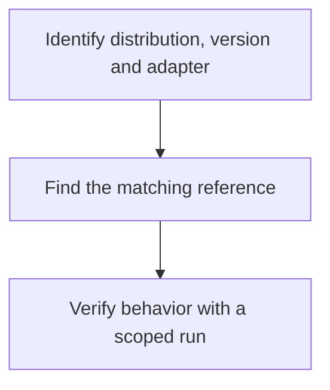

# dbt references

- [Resources](resources.md) links to the Developer Hub, the Package Hub, and upstream tool documentation.
- [Glossary](glossary.md) defines terms used throughout the curriculum.
- [Engine lesson](../lessons/0003-fusion-dbt-v2-and-dbt-oss.md) maps Core v1, dbt OSS, and the distribution previously called Fusion.

